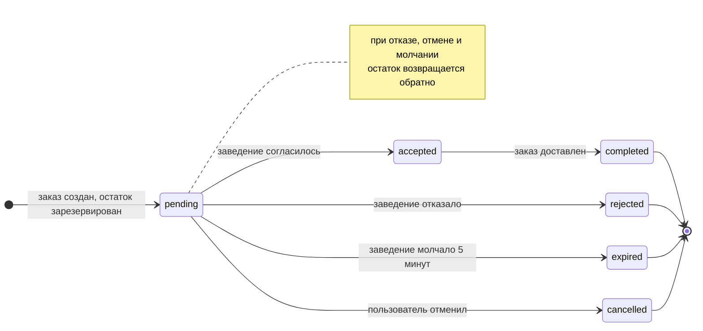

# Авито.Кухня — MVP

Сервис доставки еды. Человек выбирает, что заказать, отталкиваясь либо от заведения, либо сразу от блюда. После оформления он в реальном времени видит, что происходит с заказом, включая отказ заведения. Заведение подключается к платформе по своему API, ведёт меню и принимает заказы.

В репозитории два сервиса:

- **`kitchen`** — сама платформа. Отдаёт API пользователям и заведениям.
- **`testapi`** — тестовое заведение. Само регистрируется на платформе, заливает меню, принимает заказы и отвечает на них.

Здесь написано, **что** умеет сервис и **как** он устроен.  
Почему сделано именно так — в [`kitchen_mvp_plan.md`](kitchen_mvp_plan.md). Ссылки вида §7.3 ведут туда.
Этот же файл был техническим заданием для агента: код писался по нему, а не наоборот.

## Стек

- **Go 1.26.5** — версия зафиксирована в `go.mod`, на более ранней сборка не пройдёт.
- **PostgreSQL** — всё состояние платформы. Именно он, потому что все наши задачи закрываются одним инструментом и ни по одной не приходится идти на уступку, какие это задачи — §1.
- **Redis** — только поток событий для живого статуса заказа и ключи, отсекающие повторные заказы. Данных, которые нельзя потерять, там нет.
- **Docker Compose** — postgres, redis и оба сервиса поднимаются одной командой.
- **golangci-lint** — конфигурация в [`.golangci.yml`](.golangci.yml), запуск через `make lint`.
- **OpenAPI генерируется из кода**: `swaggo` собирает спеку по аннотациям в хендлерах, `make docs`. Обратный порядок — когда из спеки генерируют код — для одного потребителя дороже, разбор в §6.

### Библиотеки, которые влияют на устройство кода

**`avito-tech/go-transaction-manager`** — транзакциями распоряжается сервисный слой, а не репозиторий. То есть бизнес-слой занят бизнесом, а репозиторий только достаёт и кладёт данные — даже там, где транзакция сложная и охватывает несколько шагов сразу, как при создании заказа.

**`go.uber.org/fx`** — собирает приложение в одном месте и владеет запуском и остановкой фоновых частей. Поэтому в интерфейсах сервисов нет ни `Start`, ни `Shutdown`: временем жизни воркеров распоряжается сборка, а не бизнес-код.

Остальное — обычный набор: `pgx` для Postgres, `go-redis`, `goose` для миграций,
`go-playground/validator` для проверки входных данных, `caarlos0/env` для конфигурации из переменных окружения, `zap` для логов, `swaggo` для спеки, `testcontainers` для тестов.

Подробнее по каждому пункту, включая то, что решено не брать, — §1.

## Запуск

```bash
make up      # поднять всё: postgres, redis, kitchen, testapi
make logs    # смотреть логи
make down    # остановить и стереть данные
```

Без `make`: `docker compose -f deploy/docker-compose.yml up -d --build`.

Платформа слушает `:8080`, заведение — `:8081`. Миграции применяются сами при старте.

Сразу после запуска в системе уже есть одно заведение с меню из пяти позиций — это `testapi` зарегистрировался сам. Так что `GET /api/v1/places` вернёт непустой список, и можно сразу делать заказ.

Клиентской части по заданию нет, поэтому заказы делаются через `curl` или Postman.  
Принять заказ или нет решает `testapi`.

### Проверить, что всё работает

```bash
PLACE=$(curl -s localhost:8080/api/v1/places | jq -r '.[0].id')
PRODUCT=$(curl -s localhost:8080/api/v1/places/$PLACE/menu | jq -r '[.[] | select(.stock_quantity > 0)][0].product_id')
USER=$(uuidgen)

ORDER=$(curl -s -X POST localhost:8080/api/v1/orders \
  -H 'Content-Type: application/json' \
  -H "Idempotency-Key: $(uuidgen)" \
  -d "{\"user_id\":\"$USER\",\"place_id\":\"$PLACE\",\"items\":[{\"product_id\":\"$PRODUCT\",\"quantity\":1}]}")

curl -N "localhost:8080/api/v1/orders/$(echo $ORDER | jq -r .order_id)/stream?user_id=$USER"
```

Последняя команда — поток событий, в нём по очереди появятся: заказ создан, заведение согласилось, готовит, приготовило. Через полминуты `testapi` отметит заказ доставленным.

### Что тестовое заведение делает само

Оно ведёт себя как условно настоящее кафе:

- Раз в двадцать секунд **продаёт что-нибудь мимо платформы** — так же, как настоящее заведение продаёт человеку в зале. Платформа об этих продажах не знает.
- Раз в минуту **пополняет то, что кончилось**, и сообщает об этом платформе.
- На заказ отвечает согласием или отказом, по ходу готовки шлёт «готовлю» и «готово», а через полминуты отмечает заказ доставленным.

Отсюда две вещи, которые видно в работе: 
- Первая: остаток на платформе и у заведения со временем расходятся, потому что о продажах в зале платформе никто не сообщает. Если заказ получил `rejected` с причиной «не хватило» — это не поломка, а тот самый случай, платформа тут же обнуляет у себя эту позицию, чтобы больше не обещать её другим (пока реализовано только обнуление, сверка не в рамках MVP).

- Вторая: расхождение накапливается. Заведение сообщает о поставках, но не о продажах, поэтому цифра на платформе медленно уползает вверх от настоящей. Исправить это, докладывая только изменения, невозможно в принципе — нужна либо сверка по расписанию, либо возможность прислать остаток целиком, а не разницу (§7.4.1).

Выключить самодеятельность тестового заведения:  
`OFFLINE_SALES_INTERVAL=0` и `RESTOCK_INTERVAL=0`.

## Что где искать

| Что | Где |
|---|---|
| Путь пользователя | [коротко словами](#как-человек-находит-еду-и-что-может-пойти-не-так) · [картинкой в конце](#путь-пользователя) · [исходник](docs/diagrams/cjm-user.puml) |
| Путь заведения | [cjm-place.svg](docs/diagrams/cjm-place.svg) · [исходник](docs/diagrams/cjm-place.puml) |
| Контекст системы (C4, уровень 1) | [c4-context.svg](docs/diagrams/c4-context.svg) · [исходник](docs/diagrams/c4-context.puml) |
| Сервисы и хранилища (C4, уровень 2) | [ниже в разделе «Архитектура»](#архитектура) · [исходник](docs/diagrams/c4-containers.puml) |
| Внутренности заказов (C4, уровень 3) | [ниже в разделе «Архитектура»](#архитектура) · [исходник](docs/diagrams/c4-components-orders.puml) |
| Схема базы | [ниже в разделе «База»](#база) · [исходник](docs/diagrams/db-schema.puml) |
| Миграции | [`services/kitchen/migrations/`](services/kitchen/migrations/) |
| OpenAPI | [`docs/swagger.yaml`](docs/swagger.yaml) — генерируется из кода, `make docs`; живая страница — `localhost:8080/swagger/` |
| Настройки линтера | [`.golangci.yml`](.golangci.yml) |
| План, по которому писался код | [`kitchen_mvp_plan.md`](kitchen_mvp_plan.md) |

Диаграммы нарисованы кодом (PlantUML). Перерисовать после правки — `make diagrams`.

## Как человек находит еду и что может пойти не так

**Два входа в каталог, а не один.** Можно идти от заведения — список с фильтрами по городу, типу и рейтингу, потом меню. А можно идти от того, что хочется съесть: поиск блюда сразу по всем заведениям, и каждая находка приходит вместе с заведением, которому принадлежит. Второй путь и есть ответ на «как человек находит товар»: не нужно угадывать, у кого искать шаурму.

**В меню видно настоящее положение дел.** Остаток отдаётся как есть, включая ноль: закончившееся блюдо не исчезает, а показывается с нулём — как это отрисовать, решает фронт. У заведения видно, открыто ли оно **прямо сейчас**: платформа считает это по его часовому поясу, а не заставляет клиента разбираться с `opens_at` и полуночью.

Дальше — то, с чем человек сталкивается, когда что-то идёт не так. Ни один из этих случаев не отвечает пустой ошибкой:

- **Заведение закрыто.** Видно в каталоге и в карточке, до того как собрана корзина. Если всё же попытаться заказать — `409` с понятной причиной, а не молчаливый отказ.
- **Не хватило остатка.** `409`, и в теле перечислены проблемные позиции: сколько просили и сколько есть на самом деле. Клиенту есть что показать: «осталось два, оформить два?»
- **Заведение отказалось или промолчало.** Заказ уходит в `rejected` или, после пяти минут ожидания, в `expired` — и остаток возвращается обратно, так что чужой заказ не блокирует товар другим.
- **Передумал.** Пока заведение не приняло заказ, его можно отменить, остаток вернётся. После — уже нет: там готовят.

Всё это время статус едет клиенту потоком событий, без опроса. Подробный путь со всеми развилками — [картинкой в конце](#путь-пользователя).

## API

Для пользователей:

| Метод  | Путь                             | Что делает                                                                |
|--------|----------------------------------|---------------------------------------------------------------------------|
| `GET`  | `/api/v1/places`                 | список заведений; фильтры `city`, `type`, `search`, `min_rating`, `sort=rating` |
| `GET`  | `/api/v1/places/{id}`            | одно заведение: адрес, часы работы, открыто ли сейчас, рейтинг             |
| `GET`  | `/api/v1/places/{id}/menu`       | меню с остатками; фильтр `search`                                         |
| `GET`  | `/api/v1/products`               | поиск блюда сразу по всем заведениям                                      |
| `POST` | `/api/v1/orders`                 | сделать заказ; нужен заголовок `Idempotency-Key`                          |
| `GET`  | `/api/v1/orders/{id}`            | заказ целиком: позиции, цены, сумма                                       |
| `GET`  | `/api/v1/orders/{id}/stream`     | поток событий по заказу                                                   |
| `GET`  | `/api/v1/orders/{id}/tracking`   | что заведение сообщало о готовке                                          |
| `POST` | `/api/v1/orders/{id}/cancel`     | отменить, пока заведение не приняло                                       |
| `POST` | `/api/v1/orders/{id}/rate`       | оценить доставленный заказ, от 1 до 5, один раз                           |
| `GET`  | `/api/v1/users/{user_id}/orders` | свои заказы                                                               |

Для заведений — всё, кроме регистрации, требует заголовок `X-API-Key`:

| Метод    | Путь                                         | Что делает                                    |
|----------|----------------------------------------------|-----------------------------------------------|
| `POST`   | `/api/v1/b2b/places`                         | зарегистрироваться, получить ключ             |
| `PATCH`  | `/api/v1/b2b/places/{id}`                    | поменять данные заведения                     |
| `POST`   | `/api/v1/b2b/places/{id}/menu`               | залить меню                                   |
| `PATCH`  | `/api/v1/b2b/places/{id}/menu/{external_id}` | поправить позицию или остаток                 |
| `DELETE` | `/api/v1/b2b/places/{id}/menu/{external_id}` | убрать позицию из меню                        |
| `POST`   | `/api/v1/b2b/orders/{id}/tracking`           | сообщить, что заказ готовится или готов       |
| `POST`   | `/api/v1/b2b/orders/{id}/delivered`          | сообщить, что заказ отдан                     |

Ещё у обоих сервисов есть:
- `/healthz` — проверка что процесс жив
- `/readyz` для проверки состояния зависимостей (у kitchen это Postgres и Redis, testapi же всегда возвращает 200)

Что стоит знать до чтения спеки:

- **Заказ нельзя создать дважды.** Клиент присылает `Idempotency-Key`, и повтор с тем же ключом вернёт тот же заказ, а не создаст новый. Если ключ тот же, а состав заказа другой — это ошибка клиента, ответ `422`.
- **Заведение работает только со своими артикулами.** Оно присылает `external_id`, которые придумало само; внутренние идентификаторы платформы наружу не уходят.
- **Остаток на платформе — кэш, а не учёт.** Настоящий остаток лежит у заведения; наша копия отстаёт всегда, потому что о продажах в зале нам никто не сообщает. Решение по заказу принимает заведение, счётчик лишь отсекает заведомо бессмысленные запросы (§7.4.1).
- **Отказ несёт данные, а не только код.** При нехватке остатка `409` перечисляет проблемные позиции с запрошенным и доступным количеством — подробнее в разделе выше.
- **Свой заказ видно по `user_id`**, чужой отвечает `404`, а не `403` — сам факт существования чужого заказа тоже лишняя информация.
- **Пагинация по списочным эндпоинтам** — `limit` (по умолчанию 20, максимум 100) и `from`.
- **Мусор в query-параметрах не ошибка.** Буквы вместо числа, отрицательное значение, переполнение — сервис молча берёт значение по умолчанию и отвечает `200`. Ломать выдачу каталога из-за кривой ссылки хуже, чем показать первую страницу.
- **Идентификаторы** принимаются в любом регистре.

## Как проходит заказ



Когда приходит заказ, платформа одним махом уменьшает остаток и создаёт запись — если товара не хватило, не произойдёт ни того, ни другого. 
Как списали товар у себя в базе - клиенту сразу отвечаем `pending`: ждать заведение он не должен.

Дальше платформа в фоне стучится к заведению по его адресу (оставленному на этапе регистрации вебхуку) и ждёт ответа, повторяя попытки с нарастающими паузами в течение пяти минут. Ответ применяется только к заказу, который всё ещё `pending`, — поэтому отмена пользователем и решение заведения не могут перезаписать друг друга.

Пока заказ готовится, заведение может рассказывать о ходе дела: «готовлю», «готово». Эти статусы не трогают статус заказа — они идут отдельной дорожкой и просто показываются пользователю (§7.7).

Если платформа запущена в нескольких копиях, заказ закрепляется за одной из них: в записи заказа хранится, кто им занят и когда это подтверждалось. Соседняя копия заберёт заказ только если та перестала подтверждать. Поэтому заведению не приходит два одинаковых запроса. При остановке сервиса заказ остаётся `pending` и его подхватят снова, а не отменяют (§7.3).

## Архитектура

Система состоит из двух сервисов и двух хранилищ.

**`kitchen`** — платформа. Отдаёт два API: один пользователям, другой заведениям.  
Всё своё состояние держит в **Postgres**: заведения, меню с остатками, заказы, оценки. Второй копии этого состояния нигде нет, и резерв остатка попадает туда одной транзакцией вместе с заказом. Оговорка про остатки важная: платформа хранит не настоящий остаток заведения, а то, что заведение о нём сообщило, — расходиться они будут неизбежно (§7.4.1).  
**Redis** хранит поток событий по каждому заказу — из него читает поток для пользователя — и ключи, по которым отсеиваются повторные заказы.  
  
**`testapi`** — заведение. Отдельный сервис со своим меню в памяти, никакой общей базы с платформой у него нет.

Разговаривают они в обе стороны, и это важная часть картины. Заведение ходит в B2B API платформы: зарегистрироваться, залить меню, поправить остаток, сообщить о ходе готовки и о доставке. Платформа ходит к заведению на адрес, который оно оставило при регистрации, — и решение по заказу приходит прямо в ответе на этот запрос, а не отдельным вызовом.

Про доставку тут важная оговорка. Отдельного участника для неё нет: заказ закрывает само заведение, и в MVP это сознательное сокращение, а не забытая часть. По-настоящему доставка — третья сторона со своим ключом и своими статусами, и в схеме место под неё уже оставлено: у события трекинга есть поле `source`, которое допускает `delivery`, просто писать туда сейчас некому. Когда участник появится, поменяется только то, чей вызов переводит заказ в `completed` (§7.7).


Внутри платформы две независимые части: **заказы** и **заведения** (`orders` и `places`).
Заказы разрезаны ещё раз — не по слоям, а по тому, кто действует:

- `service` обрабатывает запросы пользователя: создать заказ, отменить, посмотреть, оценить;
- `decisions` живёт в фоне: разговаривает с заведением, повторяет попытки, применяет решение.

Друг друга они не видят: ни один не подключает пакет другого. Когда появляется новый заказ, `service` сообщает об этом через интерфейс из одного метода, который сам же и описал, — кто его слушает, ему неизвестно.  
Фон о запросах не знает и вовсе. Связывает их только сборка приложения,
и заменить слушателя можно, не трогая ни тот пакет, ни другой.


### Как разложен код

```text
pkg/                       общее: конфиг, логгер, health, middleware, http-сервер, redis, postgres
services/kitchen/
  migrations/              миграции
  internal/di/             сборка приложения
  internal/httpx/          разбор и валидация запросов, ответы
  internal/orders/         domain — модели и ошибки
                           service — то, что происходит внутри запроса
                           decisions — фоновая работа с заведением
                           infra, transport, di
  internal/places/         заведения и меню, та же раскладка
services/testapi/          тестовое заведение
```

Подробнее по каждому пакету — §10.

## База

Postgres, миграции — [`services/kitchen/migrations/`](services/kitchen/migrations/),
накатываются сервисом при старте.


| Таблица | Что хранит | Связи |
|---|---|---|
| `users` | заглушка вместо аутентификации: строка появляется при первом заказе | 1 → N к `orders` |
| `places` | заведение: адрес, часы работы, часовой пояс, адрес вебхука, отпечаток ключа | 1 → N к `products` и `orders` |
| `products` | позиция меню: артикул заведения, цена, остаток | N → 1 к `places`, 1 → N к `order_items` |
| `orders` | заказ: статус, сумма, кто из копий сервиса им занят | N → 1 к `users` и `places` |
| `order_items` | позиции заказа с ценой на момент покупки | N → 1 к `orders` и `products` |
| `order_tracking` | что заведение сообщало о готовке | N → 1 к `orders` |
| `order_ratings` | оценка, не больше одной на заказ | N → 1 к `orders`, `places`, `users` |
| `place_ratings` | сумма и количество оценок заведения | 1 → 1 к `places` |

Что сделано намеренно:

- Деньги — `NUMERIC`, во float не переводятся нигде.
- Цена в заказе фиксируется на момент покупки, переоценка меню его не меняет.
- Остаток не может уйти в минус — это запрещено на уровне базы, а не только в коде.
- Артикул уникален внутри заведения, и он же — индекс, по которому заведение находит свой товар.
- Позиция меню удаляется мягко, потому что на неё ссылаются прошлые заказы.
- Рейтинг хранится как сумма и счётчик, а не как среднее — целые числа не накапливают ошибку.
- Статусы заведения лежат отдельно от статуса заказа: чужие названия не попадают в наш жизненный цикл.
- Открыто ли заведение, считает база по его часовому поясу — одинаково в списке, в карточке и в поиске.

Индексы стоят под конкретные запросы, а не «на всякий случай»: каталог ищется по городу и типу среди активных заведений, меню — по заведению среди неудалённых позиций, история заказов — по пользователю от новых к старым.  
Отдельно есть частичный индекс по заказам, которые ждут решения:
по нему раз в полминуты проходит фоновая проверка, и он покрывает только их, а не всю таблицу.

## Проверки

```bash
make lint    # golangci-lint
make vet     # go vet
make test    # тесты, нужен запущенный Docker
```

Тесты внешние: поднимаются Postgres и Redis в контейнерах, собирается бинарник, и с ним разговаривают по HTTP, как это делал бы клиент. 
Отдельных тестов на функции внутри нет — это решение, а не экономия (§12). Весь прогон укладывается в полминуты.

Проверены обычные пути и то, что руками воспроизвести трудно: два процесса против одной базы, перезапуск посреди работы, молчащий вебхук, гонка на остатке, повтор заказа с тем же ключом.

Уровень логов задаётся `LOG_LEVEL`. 
- `info`: пишется только то, чего больше нигде нет — решение заведения, ручное списание остатка с причиной, подобранные зависшие заказы. 
- `debug`: добавляется жизнь заказа, по логу её читать удобнее, чем по базе.

## Настройки

`kitchen` — [`config/kitchen.env`](config/kitchen.env):

| Переменная       | Назначение                                             |
|------------------|--------------------------------------------------------|
| `DB_CONN_STRING` | подключение к Postgres                                 |
| `REDIS_ADDR`     | адрес Redis                                            |
| `LISTEN_ADDRESS` | адрес, на котором слушать                              |
| `LISTEN_PORT`    | порт                                                   |
| `LOG_LEVEL`      | уровень логов, по умолчанию `info`                     |

`testapi` — [`config/testapi.env`](config/testapi.env):

| Переменная               | Назначение                                       | По умолчанию |
|--------------------------|--------------------------------------------------|--------------|
| `KITCHEN_BASE_URL`       | адрес платформы                                  | обязательна  |
| `PUBLIC_URL`             | по какому адресу платформа достучится до вебхука | обязательна  |
| `LISTEN_ADDRESS`         | адрес, на котором слушать                        | обязательна  |
| `LISTEN_PORT`            | порт                                             | обязательна  |
| `DELIVERY_DELAY`         | через сколько отмечать заказ доставленным        | `30s`        |
| `OFFLINE_SALES_INTERVAL` | как часто продавать мимо платформы                | `20s`        |
| `RESTOCK_INTERVAL`       | как часто пополнять то, что кончилось             | `60s`        |
| `LOG_LEVEL`              | уровень логов                                    | `info`       |

Пароли лежат в репозитории намеренно: так проект поднимается одной командой и видно, что откуда берётся.

## Чего здесь нет

Полный список с обоснованием каждого пункта — §11, ближайшие планы — §13. Коротко по темам.

**Пользователь.** `user_id` клиент называет сам какой только захочет. Нет адреса доставки: раз нет профиля, некуда его положить, а одно поле «адрес» создало бы видимость готовой модели. Нет корзины — состав заказа до оформления держит клиент.

**Заведение.** Ключ выдаётся один раз и не отзывается, а сама регистрация открыта — ключ получает любой, кто позвал ручку. По ТЗ список заведений закрытый, так что по-хорошему заводить заведение должна платформа, а не оно себя само. Вебхук не подписан, и его адрес проверяется только по схеме — заведение может назвать внутренний адрес сети. Отказ «есть, но не всё» выразить нельзя: в ответе только список артикулов, без количеств. Отмена односторонняя: заведение о ней не узнаёт, потому что такой ручки в контракте нет — это самое честное упрощение из списка. И принятый заказ закрыть может только заведение: незавершённых статусов у заказа два — `pending` и `accepted`, — но дедлайн есть только у первого, поэтому партнёр, который принял заказ и замолчал, оставляет его висеть навсегда (§11).

**Меню.** Плоское, без разделов и картинок. Поиск идёт подстрокой без поискового индекса, на больших объёмах это станет медленно.

**Нагрузка.** Чтение и запись идут в одну базу, реплик под каталог нет. В каком порядке это разбирать и почему вынести остаток дороже всего — §14. Рейтинг заведения инкрементится в одну строку, и оценки популярного заведения выстроятся в очередь на ней. Поток событий держит соединение к Redis на каждого слушателя, хотя такие соединения обычно обрывают раньше, на границе. Все три упираются не сразу, но упираются — где именно, посчитано в §7.6.1.

**Надёжность.** Внешней очереди нет: заказы, по которым ещё нет ответа, находятся в самой таблице заказов — там уже есть всё нужное, чтобы продолжить работу после падения. Расписание повторов при этом живёт в памяти процесса, и перезапуск восстанавливает его лишь приблизительно.

**Доставка.** Отдельного участника нет: заказ закрывает само заведение. Когда появится курьер, закрывать будет он — поменяется только то, чей вызов переводит заказ в `completed`. Для пользователя не изменится ничего: оценка как была привязана к доставленному заказу, так и останется.

**В настоящем сервисе** ещё понадобились бы: нормальная аутентификация вместо самодекларации, подписанные запросы для партнёров, обратный прокси с TLS и ограничением размера запроса, брокер — но не ради надёжности доставки, а когда у события появится второй потребитель (§7.3).

## Путь пользователя

Что человек делает, что при этом происходит на платформе и у заведения, включая отказы. Путь
заведения — [отдельной картинкой](docs/diagrams/cjm-place.svg).


