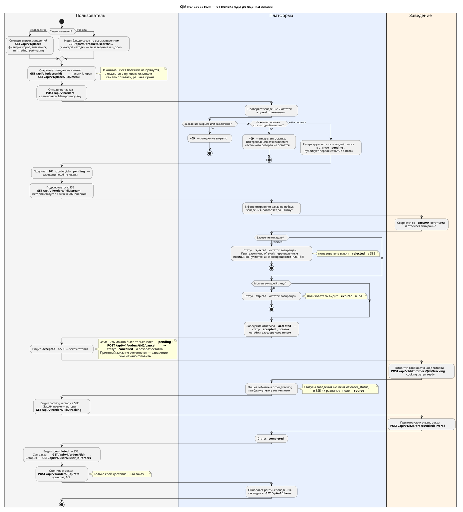
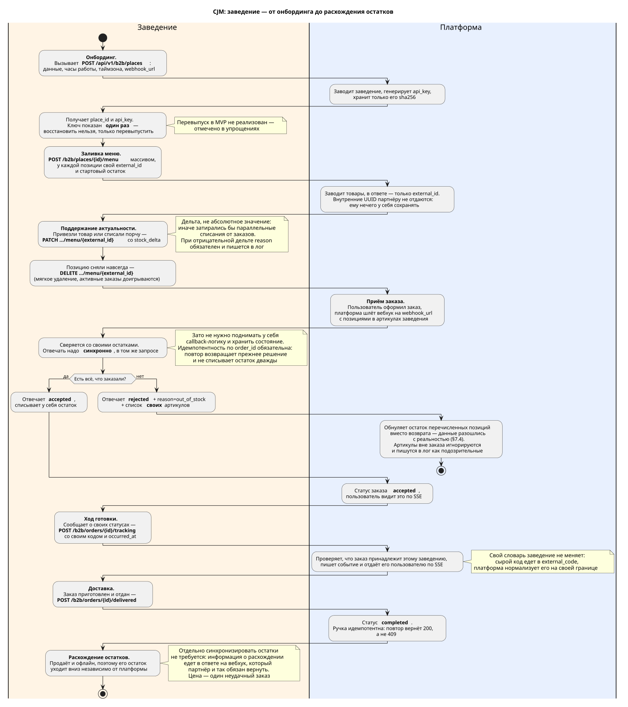
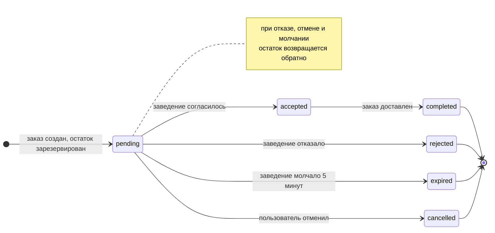
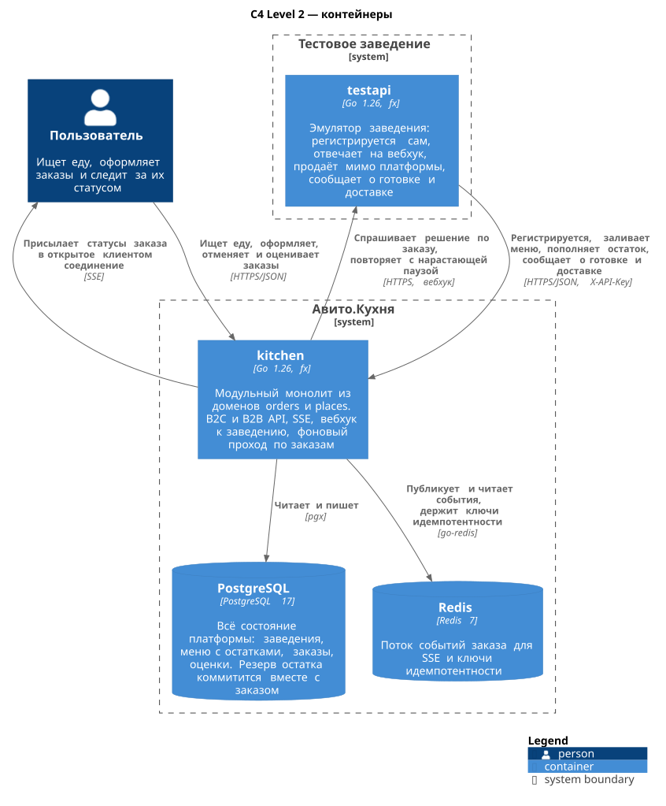
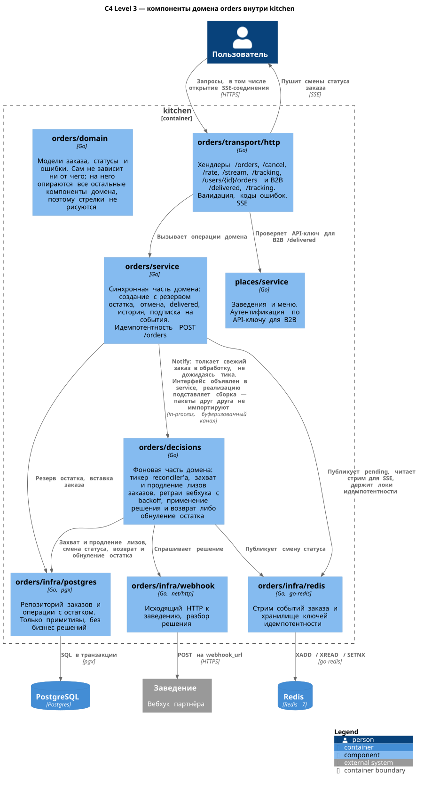
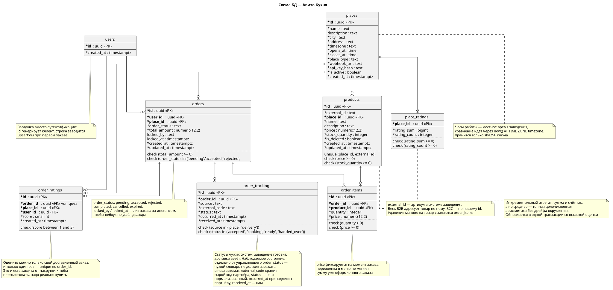

# Авито.Кухня — MVP

Сервис доставки еды. Человек выбирает, что заказать, отталкиваясь либо от заведения, либо сразу от блюда. После оформления он в реальном времени видит, что происходит с заказом, включая отказ заведения. Заведение подключается к платформе по своему API, ведёт меню и принимает заказы.

В репозитории два сервиса:

- **`kitchen`** — сама платформа. Отдаёт API пользователям и заведениям.
- **`testapi`** — тестовое заведение. Само регистрируется на платформе, заливает меню, принимает заказы и отвечает на них.

> **Что изменилось с изначальной отправки.** Решение, отправленное в сентябре, — [версия v0.1.0](https://github.com/Krovenmor/avito-backend-trainee-assignment-autumn-2026/tree/53bb6e0). В октябре, перед повторным рассмотрением, проект немного доработан, все правки — один коммит v0.1.1. В основном переработана документация: исходный план разделён на [план](docs/plan.md) и [решения](docs/decisions.md), README и диаграммы переписаны для лучшей читаемости и сверены с кодом. Также исправлены два бага: `500` на нечисловом `min_rating` и повторные вызовы вебхука после отмены заказа. На оба бага и на одновременные заказы добавлены тесты.

Этот README — чтобы быстро разобраться и запустить. Подробно, как устроена каждая часть, описано в [плане](docs/plan.md). Почему выбрано именно так и чем за это приходится платить — в [решениях](docs/decisions.md).

## Сводка

| Что | Где |
|---|---|
| Запуск через Docker Compose | `make up`, проверка одним блоком команд — [Запуск](#запуск) |
| CJM пользователя и заведения | [Путь пользователя и заведения](#путь-пользователя-и-заведения), исходники на PlantUML в [`docs/diagrams/`](docs/diagrams/) |
| Миграции | [`services/kitchen/migrations/`](services/kitchen/migrations/), накатываются при старте |
| OpenAPI | [`docs/swagger.yaml`](docs/swagger.yaml), живая страница — `localhost:8080/swagger/` |
| Архитектура, C4 | [Архитектура](#архитектура) |
| Схема БД | [База](#база) |
| Тестовое заведение | [`services/testapi/`](services/testapi/), что оно делает — [ниже](#что-делает-тестовое-заведение) |
| Как связаны данные платформы, заведений и пользователей | [план, «Идентификаторы»](docs/plan.md#идентификаторы), почему так — [Р5](docs/decisions.md#р5-заведение-работает-со-своими-артикулами) |
| Линтер | [`.golangci.yml`](.golangci.yml), `make lint` |
| Кодогенерация API | спека собирается из кода, а не наоборот — [Р6](docs/decisions.md#р6-спека-из-кода-а-не-код-из-спеки) |
| Главные технические решения | [Главные решения](#главные-решения), подробно — [`docs/decisions.md`](docs/decisions.md) |
| Упрощения и слабые места | [Чего здесь нет](#чего-здесь-нет) |
| План, по которому писался код | [`docs/kitchen_mvp_plan.md`](docs/kitchen_mvp_plan.md) — исходный промпт для агента. [`docs/plan.md`](docs/plan.md) и [`docs/decisions.md`](docs/decisions.md) — его переработанная для чтения версия |

## Запуск

```bash
make up      # поднять всё: postgres, redis, kitchen, testapi
make logs    # смотреть логи
make down    # остановить и стереть данные
```

Без `make`: `docker compose -f deploy/docker-compose.yml up -d --build`.

Платформа слушает `:8080`, заведение — `:8081`. Миграции применяются сами при старте.

Сразу после запуска в системе уже есть одно заведение с меню из пяти позиций: это `testapi` зарегистрировался сам. Клиентской части по заданию нет, поэтому заказы делаются через `curl` или Postman, а принимает их или отказывает `testapi`.

### Проверить, что всё работает

Нужны `curl`, `jq` и `uuidgen`.

```bash
PLACE=$(curl -s localhost:8080/api/v1/places | jq -r '.[0].id')
PRODUCT=$(curl -s localhost:8080/api/v1/places/$PLACE/menu | jq -r '[.[] | select(.stock_quantity > 0)][0].product_id')
USER_ID=$(uuidgen)

ORDER=$(curl -s -X POST localhost:8080/api/v1/orders \
  -H 'Content-Type: application/json' \
  -H "Idempotency-Key: $(uuidgen)" \
  -d "{\"user_id\":\"$USER_ID\",\"place_id\":\"$PLACE\",\"items\":[{\"product_id\":\"$PRODUCT\",\"quantity\":1}]}")

curl -sN "localhost:8080/api/v1/orders/$(echo $ORDER | jq -r .order_id)/stream?user_id=$USER_ID"
```

Последняя команда открывает поток событий по заказу. В нём появятся: заказ создан (`pending`), заведение согласилось (`accepted`), готовит (`cooking`), готово (`ready`). Через полминуты `testapi` отметит заказ доставленным, и придёт `completed`.

`cooking` иногда приходит раньше `accepted`, и это нормально. Статус заказа и сообщения заведения о готовке — две независимые дорожки, их различает поле `source` ([Р15](docs/decisions.md#р15-статусы-заведения--отдельная-дорожка)).

### Что делает тестовое заведение

Оно ведёт себя как обычное кафе:

- раз в 20 секунд продаёт что-нибудь посетителю в зале, мимо платформы, и платформе об этом не сообщает,
- раз в минуту пополняет то, что кончилось, и об этом платформе сообщает,
- на заказ отвечает согласием или отказом, по ходу шлёт «готовлю» и «готово», а через полминуты отмечает заказ доставленным.

Поэтому остаток на платформе со временем расходится с остатком у заведения. Если заказ получил `rejected` с причиной «не хватило», это не поломка, а ровно этот случай: платформа сразу обнуляет у себя позицию, чтобы больше не обещать её другим ([Р12](docs/decisions.md#р12-остаток-на-платформе--копия-со-слов-заведения)).

Выключить продажи в зале и пополнение: `OFFLINE_SALES_INTERVAL=0` и `RESTOCK_INTERVAL=0` в [`config/testapi.env`](config/testapi.env).

## Путь пользователя и заведения

### Как человек находит еду

**Два входа в каталог.** Можно идти от заведения: список с фильтрами по городу, типу и рейтингу, потом меню. А можно от того, что хочется съесть: поиск блюда сразу по всем заведениям, и каждая находка приходит вместе со своим заведением. Второй путь и есть ответ на вопрос «как человек находит товар»: не нужно угадывать, у кого искать шаурму.

**В меню видно, что есть на самом деле.** Остаток отдаётся как есть: закончившееся блюдо не пропадает, а показывается с нулём. У заведения видно, открыто ли оно прямо сейчас — платформа считает это по его часовому поясу.

### Что может пойти не так

Ни один из этих случаев не заканчивается пустой ошибкой:

- **Заведение закрыто.** Это видно в каталоге ещё до заказа. Если всё же попытаться заказать — `409` с понятной причиной.
- **Не хватило остатка.** `409`, и в ответе перечислены проблемные позиции: сколько просили и сколько есть. Клиенту есть что показать: «осталось два, оформить два?»
- **Заведение отказало или молчит.** Заказ становится `rejected` или, через пять минут ожидания, `expired`, а остаток возвращается, чтобы не блокировать товар другим.
- **Передумал.** Пока заведение не приняло заказ, его можно отменить, остаток вернётся. После — уже нет, там готовят.

Всё это время статус приходит клиенту потоком событий, без опроса.

### Путь пользователя

Что человек делает и что при этом происходит на платформе и у заведения, вместе с отказами.



### Путь заведения

Регистрация, меню, поддержание остатка, приём заказа через вебхук, ход готовки, доставка и то, как расходятся остатки.



Диаграммы нарисованы кодом на PlantUML, исходники лежат рядом, в [`docs/diagrams/`](docs/diagrams/). Перерисовать после правки — `make diagrams`. Те же пути текстом, с ручками API, — в [плане, §2](docs/plan.md#2-путь-пользователя-и-заведения).

## Как проходит заказ



Когда приходит заказ, платформа одним действием уменьшает остаток и записывает заказ. Если товара не хватило, не произойдёт ни того, ни другого. Клиент сразу получает `pending`: ждать заведение он не должен.

Дальше платформа в фоне отправляет заказ на адрес, который заведение оставило при регистрации, и ждёт решения в ответе. Если заведение не отвечает, она повторяет попытки с нарастающими паузами в течение пяти минут. Решение применяется, только если заказ всё ещё `pending`, поэтому отмена пользователем и ответ заведения не могут перезаписать друг друга.

Пока заказ готовится, заведение может сообщать о ходе дела: «готовлю», «готово». Эти сообщения не меняют статус заказа, а просто показываются пользователю.

Если платформа запущена в нескольких копиях, каждый заказ закреплён за одной из них, и заведению не приходит два одинаковых запроса. При остановке сервиса заказ остаётся `pending`, и его подхватят снова. Подробно — [план, §7](docs/plan.md#7-как-заказ-получает-ответ-заведения).

## Архитектура

Два сервиса и два хранилища.

- **`kitchen`** — платформа. Отдаёт два API: пользователям и заведениям. Всё состояние держит в **Postgres**: заведения, меню с остатками, заказы, оценки.
- **Redis** хранит поток событий по каждому заказу, из которого клиент получает статусы, и ключи, по которым отсекаются повторные заказы. Ничего, без чего заказ не дойдёт до конца, в Redis нет.
- **`testapi`** — заведение. Отдельный сервис со своим складом в памяти, общей базы с платформой у него нет.

Разговаривают они в обе стороны. Заведение ходит в B2B API платформы: регистрируется, заливает меню, правит остаток, сообщает о готовке и доставке. Платформа ходит к заведению на его вебхук, и решение по заказу приходит прямо в ответе на этот запрос.



Внутри платформы две части: заказы и заведения (`orders` и `places`). Заказы разделены ещё раз — по тому, кто выполняет работу:

- `service` обрабатывает запросы пользователя: создать заказ, отменить, посмотреть, оценить,
- `decisions` работает в фоне: связывается с заведением, повторяет попытки, применяет решение.

Друг друга они не импортируют, связывает их только сборка приложения. Новый заказ `service` передаёт через интерфейс из одного метода, который сам же и объявил.



Есть и диаграмма [C4 Level 1](docs/diagrams/c4-context.svg) — система целиком и кто с ней разговаривает. Подробно про домены, слои и раскладку кода — [план, §1](docs/plan.md#1-из-чего-состоит-система).

## База

Postgres, [миграции](services/kitchen/migrations/) накатываются сервисом при старте.



| Таблица | Что хранит | Связи |
|---|---|---|
| `users` | заглушка вместо пользователей: строка появляется при первом заказе | 1 → N к `orders` |
| `places` | заведение: адрес, часы работы, часовой пояс, адрес вебхука, отпечаток ключа | 1 → N к `products` и `orders` |
| `products` | позиция меню: артикул заведения, цена, остаток | N → 1 к `places`, 1 → N к `order_items` |
| `orders` | заказ: статус, сумма, какая копия сервиса им занята | N → 1 к `users` и `places` |
| `order_items` | позиции заказа с ценой на момент покупки | N → 1 к `orders` и `products` |
| `order_tracking` | что заведение сообщало о готовке | N → 1 к `orders` |
| `order_ratings` | оценка, не больше одной на заказ | N → 1 к `orders`, `places`, `users` |
| `place_ratings` | сумма и количество оценок заведения | 1 → 1 к `places` |

Что стоит знать:

- Деньги хранятся в `NUMERIC` и в дробные числа не переводятся нигде.
- Цена в заказе фиксируется на момент покупки, смена цены в меню на неё не влияет.
- Остаток не может уйти в минус: это запрещено на уровне базы, а не только в коде.
- Позиция меню удаляется мягко, потому что на неё ссылаются прошлые заказы.
- Статусы заведения лежат отдельно от статуса заказа.
- Открыто ли заведение, считает база по его часовому поясу — одинаково в списке, в карточке и в поиске.
- Индексы стоят под конкретные запросы: каталог по городу и типу, меню заведения, история заказов пользователя, ждущие решения заказы.

Все колонки, ограничения и индексы — [план, §4](docs/plan.md#4-база-данных).

## API

Полная спецификация — [`docs/swagger.yaml`](docs/swagger.yaml), живая страница — `localhost:8080/swagger/`. Все пути начинаются с `/api/v1`.

<details>
<summary><b>Все ручки</b> — 11 для пользователей, 7 для заведений</summary>

Для пользователей:

| Метод  | Путь                       | Что делает                                                    |
|--------|----------------------------|---------------------------------------------------------------|
| `GET`  | `/places`                  | список заведений, фильтры по городу, типу, названию и рейтингу |
| `GET`  | `/places/{id}`             | одно заведение: адрес, часы работы, открыто ли сейчас, рейтинг |
| `GET`  | `/places/{id}/menu`        | меню с остатками, поиск по названию                           |
| `GET`  | `/products`                | поиск блюда сразу по всем заведениям                          |
| `POST` | `/orders`                  | сделать заказ, нужен заголовок `Idempotency-Key`              |
| `GET`  | `/orders/{id}`             | заказ целиком: позиции, цены, сумма                           |
| `GET`  | `/orders/{id}/stream`      | поток событий по заказу                                       |
| `GET`  | `/orders/{id}/tracking`    | что заведение сообщало о готовке                              |
| `POST` | `/orders/{id}/cancel`      | отменить, пока заведение не приняло                           |
| `POST` | `/orders/{id}/rate`        | оценить доставленный заказ, от 1 до 5, один раз               |
| `GET`  | `/users/{user_id}/orders`  | свои заказы                                                   |

Для заведений — всё, кроме регистрации, требует заголовок `X-API-Key`:

| Метод    | Путь                                     | Что делает                                 |
|----------|------------------------------------------|--------------------------------------------|
| `POST`   | `/b2b/places`                            | зарегистрироваться, получить ключ          |
| `PATCH`  | `/b2b/places/{id}`                       | поменять данные заведения                  |
| `POST`   | `/b2b/places/{id}/menu`                  | залить меню                                |
| `PATCH`  | `/b2b/places/{id}/menu/{external_id}`    | поправить позицию или остаток              |
| `DELETE` | `/b2b/places/{id}/menu/{external_id}`    | убрать позицию из меню                     |
| `POST`   | `/b2b/orders/{id}/tracking`              | сообщить, что заказ готовится или готов    |
| `POST`   | `/b2b/orders/{id}/delivered`             | сообщить, что заказ отдан                  |

У обоих сервисов есть `/healthz` — процесс жив — и `/readyz` — доступны ли зависимости. У `kitchen` это Postgres и Redis, у `testapi` зависимостей нет, и он всегда отвечает `200`.

</details>

Что полезно знать заранее:

- **Заказ нельзя создать дважды.** Повтор с тем же `Idempotency-Key` вернёт тот же заказ. Тот же ключ с другим составом заказа — ошибка клиента, `422`.
- **Заведение работает только со своими артикулами** (`external_id`), наши идентификаторы ему не нужны.
- **Отказ несёт данные.** При нехватке остатка `409` перечисляет проблемные позиции.
- **Свой заказ видно по `user_id`**, чужой отвечает `404`, а не `403`.
- **Мусор в необязательных параметрах не ошибка.** Кривой `limit` или `min_rating` заменяется значением по умолчанию, ответ остаётся `200`.
- **Идентификаторы принимаются в любом регистре.**

Коды ответов по каждой ручке и контракт вебхука — [план, §5](docs/plan.md#5-api) и [§2.3](docs/plan.md#23-путь-заведения).

## Главные решения

На чём держится система и какие тесты это проверяют. Подробно про каждое решение — в [решениях](docs/decisions.md).

**Заказ, который ждёт заведение, не теряется при падении и не уходит заведению дважды.** Отдельной очереди нет: ждущие заказы — это строки в статусе `pending`. Фоновый проход раз в 30 секунд подбирает их после перезапуска, а если копий сервиса несколько, каждый заказ закреплён за одной из них ([Р9](docs/decisions.md#р9-внешней-очереди-нет), [Р10](docs/decisions.md#р10-заказ-закрепляется-арендой-в-таблице)).
Проверяют: [`orders_lease_test.go`](tests/orders_lease_test.go) — вторая копия сервиса против той же базы, вебхук уходит один раз. [`orders_restart_test.go`](tests/orders_restart_test.go) — перезапущенная копия сразу возвращается к своему заказу. [`orders_drain_test.go`](tests/orders_drain_test.go) — при остановке посреди вызова заказ остаётся `pending`, а не теряется.

**Остаток не уходит в минус.** Резерв и запись заказа — одна транзакция, проверка остатка и списание — один запрос, а строки товаров везде блокируются в одном порядке ([план §6](docs/plan.md#6-создание-заказа), [§8](docs/plan.md#8-остаток-при-отказе)).
Проверяют: [`orders_create_test.go`](tests/orders_create_test.go) — двадцать одновременных заказов на товар с остатком 3: проходят ровно три, остальные получают `409`, отклонённые не резервируют ничего, а встречный порядок позиций не приводит к взаимной блокировке. Там же нехватка остатка, когда один товар повторяется в заказе. [`orders_duplicate_items_test.go`](tests/orders_duplicate_items_test.go) — возврат остатка при отмене такого заказа.

**Остаток на платформе — копия со слов заведения.** Сам учёт ведёт заведение, а расхождение обнаруживается в его ответе на заказ: «не хватило» обнуляет позицию на платформе ([Р12](docs/decisions.md#р12-остаток-на-платформе--копия-со-слов-заведения)).
Проверяют: [`testapi_test.go`](tests/testapi_test.go) — продажи в зале опустошают склад заведения, и платформа сама обнуляет остаток. [`orders_lifecycle_test.go`](tests/orders_lifecycle_test.go) — артикулы, которых нет в заказе, обнулить нельзя.

**Заведение работает своими артикулами.** Наши идентификаторы товаров наружу не уходят, и внутреннюю схему можно менять, не ломая интеграцию ([Р5](docs/decisions.md#р5-заведение-работает-со-своими-артикулами)).
Проверяет: [`places_menu_test.go`](tests/places_menu_test.go) — в ответе на заливку меню только артикулы, без наших идентификаторов.

**Статусы заведения не смешиваются со статусом заказа.** «Готовлю» и «готово» идут отдельной дорожкой и не влияют на правила заказа ([Р15](docs/decisions.md#р15-статусы-заведения--отдельная-дорожка)).
Проверяет: [`orders_tracking_test.go`](tests/orders_tracking_test.go) — сообщение заведения доходит до пользователя, а чужое заведение по чужому заказу писать не может.

## Проверки

```bash
make lint    # golangci-lint
make vet     # go vet
make test    # тесты, нужен запущенный Docker
```

Тесты внешние: они поднимают Postgres и Redis в контейнерах, собирают сервис, запускают его отдельным процессом и шлют ему HTTP-запросы, как клиент. Юнит-тестов нет, почему — в [Р16](docs/decisions.md#р16-тесты-только-внешние). Прогон занимает около полуминуты.

Тесты на главные решения перечислены выше. Кроме них отдельно проверены отмена, после которой платформа перестаёт звонить заведению, повтор заказа с тем же ключом, ответ заведения не по формату, вход по ключу чужого заведения и часы работы через полночь.

## Чего здесь нет

Почему и что с этим делать — по ссылкам. Самое важное, о чём стоит знать заранее:

- **Redis здесь лишний.** При пересмотре проекта через месяц стало видно, что он был добавлен без достаточных оснований: обе его задачи — поток событий для статусов и ключи от повторных заказов — решаются средствами Postgres. Это главный кандидат на удаление ([Р2](docs/decisions.md#р2-redis--только-для-того-что-можно-потерять)).
- **Отмена не доходит до заведения.** Если заведение успело принять заказ, который пользователь уже отменил, оно его приготовит ([подробно](docs/decisions.md#отмена-не-доходит-до-заведения)).
- **У принятого заказа нет срока.** Если заведение приняло заказ и пропало, он навсегда остаётся `accepted` ([подробно](docs/decisions.md#у-accepted-нет-срока)).
- **Регистрация заведения открыта**, хотя по ТЗ список заведений закрытый ([подробно](docs/decisions.md#регистрация-заведения-открыта-всем)).

Остальное коротко:

- **Пользователь:** нет [аутентификации](docs/decisions.md#нет-аутентификации), [адреса доставки](docs/decisions.md#нет-адреса-доставки) и [корзины на сервере](docs/decisions.md#нет-корзины-на-сервере).
- **Заведение:** [ключ не перевыпускается](docs/decisions.md#ключ-заведения-не-перевыпускается), [вебхук не подписан](docs/decisions.md#вебхук-не-подписан), [адрес вебхука проверяется только по схеме](docs/decisions.md#адрес-вебхука-проверяется-только-по-схеме), в ответе на заказ [нет количеств](docs/decisions.md#р12-остаток-на-платформе--копия-со-слов-заведения), [причина отказа влияет только на остаток](docs/decisions.md#причина-отказа-влияет-только-на-остаток).
- **Каталог:** [нет категорий и фото](docs/decisions.md#меню-без-категорий-и-изображений), [поиск без индекса](docs/decisions.md#поиск-без-индекса), [нет кэша меню](docs/decisions.md#кэша-меню-нет), [списки без общего количества](docs/decisions.md#списки-без-общего-количества).
- **Эксплуатация:** [нет ограничения частоты запросов](docs/decisions.md#нет-ограничения-частоты-запросов), [нет обратного прокси](docs/decisions.md#перед-kitchen-нет-обратного-прокси), [пароли базы лежат в репозитории](docs/decisions.md#пароли-базы-лежат-в-репозитории), [расписание повторов вебхука живёт в памяти](docs/decisions.md#р9-внешней-очереди-нет), [`testapi` регистрируется заново на каждом рестарте](docs/decisions.md#testapi-регистрируется-заново-на-каждом-рестарте).
- **Доставка:** [отдельного участника нет](docs/decisions.md#доставка--не-отдельный-участник), заказ закрывает само заведение.

Как систему разбирать при росте — [в решениях](docs/decisions.md#как-система-будет-расти).

## Справочник

<details>
<summary><b>Стек</b></summary>

| Что | Зачем |
|---|---|
| Go 1.26.5 | версия зафиксирована в `go.mod`, на более ранней сборка не пройдёт |
| PostgreSQL 17 | всё состояние платформы ([Р1](docs/decisions.md#р1-postgres--единственное-хранилище-состояния)) |
| Redis 7 | поток событий для статусов в реальном времени и ключи повторных заказов ([Р2](docs/decisions.md#р2-redis--только-для-того-что-можно-потерять)) |
| `go.uber.org/fx` | сборка приложения, запуск и остановка фоновых частей ([Р4](docs/decisions.md#р4-транзакции-открывает-сервис-правила-держит-sql)) |
| `avito-tech/go-transaction-manager` | транзакции открывает сервисный слой, а не репозиторий ([Р4](docs/decisions.md#р4-транзакции-открывает-сервис-правила-держит-sql)) |
| `pgx`, `go-redis`, `goose` | драйверы Postgres и Redis, миграции |
| `go-playground/validator`, `caarlos0/env`, `zap` | проверка входных данных, конфигурация из окружения, логи |
| `swaggo` | спека OpenAPI из аннотаций в коде ([Р6](docs/decisions.md#р6-спека-из-кода-а-не-код-из-спеки)) |
| `testcontainers` | Postgres и Redis для тестов ([Р16](docs/decisions.md#р16-тесты-только-внешние)) |
| `golangci-lint` | линтер, конфигурация в [`.golangci.yml`](.golangci.yml) |
| Docker Compose | всё поднимается одной командой |

</details>

<details>
<summary><b>Настройки</b></summary>

`kitchen` — [`config/kitchen.env`](config/kitchen.env):

| Переменная       | Назначение                         |
|------------------|------------------------------------|
| `DB_CONN_STRING` | подключение к Postgres             |
| `REDIS_ADDR`     | адрес Redis                        |
| `LISTEN_ADDRESS` | адрес, на котором слушать          |
| `LISTEN_PORT`    | порт                               |
| `LOG_LEVEL`      | уровень логов, по умолчанию `info` |

`testapi` — [`config/testapi.env`](config/testapi.env):

| Переменная               | Назначение                                       | По умолчанию |
|--------------------------|--------------------------------------------------|--------------|
| `KITCHEN_BASE_URL`       | адрес платформы                                  | обязательна  |
| `PUBLIC_URL`             | по какому адресу платформа достучится до вебхука | обязательна  |
| `LISTEN_ADDRESS`         | адрес, на котором слушать                        | обязательна  |
| `LISTEN_PORT`            | порт                                             | обязательна  |
| `DELIVERY_DELAY`         | через сколько отмечать заказ доставленным        | `30s`        |
| `OFFLINE_SALES_INTERVAL` | как часто продавать мимо платформы               | `20s`        |
| `RESTOCK_INTERVAL`       | как часто пополнять то, что кончилось            | `60s`        |
| `LOG_LEVEL`              | уровень логов                                    | `info`       |

Пароли лежат в репозитории намеренно: так проект поднимается одной командой и видно, что откуда берётся.

</details>

<details>
<summary><b>Раскладка кода</b></summary>

```text
pkg/                       общее: конфиг, логгер, health, middleware, http-сервер, redis, postgres
services/kitchen/
  migrations/              миграции
  internal/di/             сборка приложения
  internal/httpx/          разбор и валидация запросов, ответы
  internal/orders/         domain — модели и ошибки
                           service — то, что происходит внутри запроса
                           decisions — фоновая работа с заведением
                           infra, transport, di
  internal/places/         заведения и меню, та же раскладка
services/testapi/          тестовое заведение
tests/                     внешние тесты
docs/                      план, решения, исходный план, OpenAPI, диаграммы
```

Подробно по каждому пакету — [план, §12](docs/plan.md#12-раскладка-кода).

</details>

<details>
<summary><b>Логи</b></summary>

Уровень задаётся `LOG_LEVEL`.

- `info` — только то, чего больше нигде нет: решение заведения, ручное списание остатка с причиной, подобранные после сбоя заказы.
- `debug` — плюс жизнь заказа по шагам. Её видно и в базе, но по логу читать удобнее.

</details>
