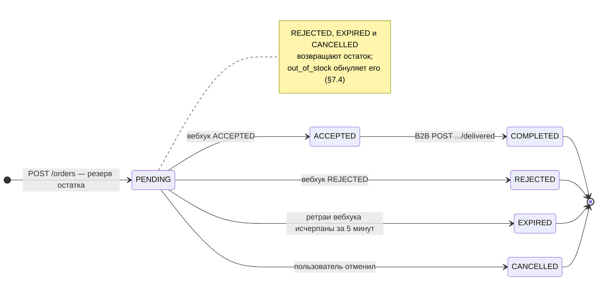

# Инженерный план MVP платформы «Авито.Кухня»

> Диаграммы (CJM в PlantUML, C4) сознательно не делались на этапе плана — рисовать их до того,
> как написан код, означает потом вручную гоняться за их актуальностью. Нарисованы в конце,
> когда реализация стабилизировалась: исходники в `docs/diagrams/`, пересборка — `make diagrams`.

## 1. Технологический стек

*   **Язык:** Go 1.26 (`go.mod` требует 1.26.5 — сборка на более ранней не пройдёт).
*   **Архитектура:** Модульный монолит. Два домена внутри одного сервиса `kitchen`: `orders` и `places` (см. §2).

*   **Сборка приложения:** `go.uber.org/fx`. Даёт три вещи, ради которых он и взят. Первая — единственное место, где зависимости соединяются: ни один пакет не создаёт себе соседа сам. Вторая — владение временем жизни: фоновые воркеры поднимаются в `OnStart` и дожидаются завершения в `OnStop`, поэтому в интерфейсе `Service` нет ни `Start`, ни `Shutdown` — бизнес-код про свой запуск не знает (§7.3). Третья — один конструктор репозитория отдаётся под несколькими узкими интерфейсами через `fx.Annotate`/`fx.As` (8 таких привязок), без промежуточных обёрток и без второго экземпляра пула.

    Цена: ошибки в графе зависимостей переезжают из компиляции в старт приложения, а сам граф нигде не выписан явно — его надо собирать в голове из `Provide`. Для сервиса на пару зависимостей это был бы перебор; здесь оправдано двумя сервисами, фоновыми воркерами с корректной остановкой и восемью интерфейсами от одного конструктора.
*   **База данных:** PostgreSQL + `pgx`. ACID выбор не обосновывает — его дают все. Обосновывает то, на что опираются решения и что понадобится дальше.

    Уже используется: блокировки отдельных строк, без которых не работает владение заказом между копиями сервиса (`FOR UPDATE SKIP LOCKED` при разборе, `FOR UPDATE` по возрастанию `id` при работе с остатком, §7.5.1); пишущие CTE, `RETURNING` и передача списка одним параметром — они сворачивают несколько обращений в одно и тем убирают окно между ними; частичные индексы, три штуки.

    Понадобится дальше: `GIN` под полнотекстовый поиск по меню вместо `ILIKE` (§11), геоданные под зону доставки, `JSONB` под разнородные поля, при росте — секционирование заказов и логика на стороне сервера, если она станет дешевле сетевого round-trip.

    Встроенные базы вроде SQLite отпадают не по SQL — там есть и `RETURNING`, и частичные индексы, — а потому что пишущий может быть только один и блокировок на строки нет.

    Ни одна из перечисленных задач по отдельности не уникальна. Именно Postgres потому, что все они закрываются одним инструментом и ни по одной не приходится идти на уступку.

*   **Транзакции:** `avito-tech/go-transaction-manager`. Границей транзакции распоряжается сервисный слой: создание заказа — это проверка заведения, захват товаров, резерв остатка и вставка, и атомарным должен быть весь набор, а не каждый шаг. Транзакция едет в контексте: сервис оборачивает шаги в `trm.Do`, репозиторий спрашивает `DefaultTrOrDB(ctx, pool)` и получает соединение из транзакции либо из пула. Поэтому `ReserveStock(ctx, items)` и `InsertOrder(ctx, params)` выглядят одинаково внутри транзакции и снаружи — чего не дают ни `tx` параметром (инфраструктурный тип течёт в сигнатуры бизнес-слоя), ни `WithTx(fn)` (оркестрация возвращается в репозиторий).

    То, что по сигнатуре репозитория не видно, идёт вызов в транзакции или нет, — не плата, а цель: атомарность решает сценарий, а не операция доступа к данным, и `InsertOrder` вставляет строку одинаково в обоих случаях. Платим за другое: компилятор не может обязать обернуть. Забытый `trm.Do` в новом сценарии молча превратит набор шагов в отдельные автокоммиты — остаток спишется, заказ не вставится, откатывать будет нечего. При передаче `tx` параметром это была бы ошибка сборки. Смягчается тем, что границы заданы в одном слое и их пять на весь проект, а при необходимости включается `PropagationMandatory` — режим, в котором вызов без активной транзакции возвращает ошибку.

    Своё не писал: ядро небольшое, но откат при панике и вложенные вызовы забываются легко. Зависимость при этом почти невесома — 6 пакетов из 410 в собранном бинаре.

*   **Redis:** `go-redis/v9` — только там, где он незаменим: стрим событий заказа для SSE (нужен фанаут между инстансами, in-process каналами не решается) и `SETNX` для идемпотентности `POST /orders`. Очереди в Redis нет: работа по заказу восстанавливается из Postgres, где статус `pending` и есть отметка «ждём решения» (§7.3). Кэш меню — вне скоупа MVP.
*   **Логирование:** `zap`, уровень через `LOG_LEVEL` (по умолчанию `info`). Критерий разделения: `Info` — факт, который больше нигде не записан (решение заведения, причина ручного списания остатка, работа reconciler'а); `Debug` — то, что дублирует состояние в БД (создание, отмена и доставка заказа) и потому нужно только при разборе.
*   **Конфигурация:** `caarlos0/env` — структуры с тегами и `required`/`envDefault`, без ручного разбора окружения.
*   **Миграции:** `goose/v3`.
*   **Документация API:** `swaggo/swag`.
*   **Линтинг:** `golangci-lint` + `.golangci.yml` в корне репозитория.
*   **CORS:** открыт для всех origin — по ТЗ клиент браузерный, без этого `fetch` и `EventSource` до API не дотянутся.
*   **Инфраструктура:** Docker + `docker-compose` (БД, Redis, `kitchen`, `testapi`-эмулятор заведения).

## 2. Домены и границы ответственности

Два домена внутри одного сервиса `kitchen`. Ниже — кто за что отвечает и почему граница проведена именно так.

**`places` — факт "что это за место и что оно продаёт".**
CRUD заведений (регистрация, часы работы, `is_active`) и CRUD товаров (создание, `name`/`description`/`price`, ручная корректировка остатка через `stock_delta`). Актор — заведение (B2B, API-key). Единственный домен, которому разрешено произвольно менять состояние заведения/товара по любой причине — "я владелец, я меняю что хочу".

**`orders` — жизненный цикл конкретного заказа.**
Создание заказа (резерв остатка + запись заказа атомарно), конечный автомат статусов, идемпотентность, возврат остатка при отказе/отмене/истечении, получение решения заведения и рассылка статуса клиенту. Актор — анонимный пользователь (B2C, без auth). Не "любое изменение товара", а ровно регламентированные операции с остатком, встроенные в конечный автомат заказа — другая природа операции и другой актор, чем у `places`.
*Единственное исключение из "не лезь в чужие таблицы":* прямой SQL по `products.stock_quantity` (резерв/возврат/обнуление) внутри своей транзакции — ради атомарности с созданием заказа (см. §7.5). `orders` не имеет права трогать `name`/`price`/`description` — это зона исключительно `places`.

**Почему I/O не выделен в отдельный домен.** Исходящий вебхук и SSE — это транспорт, а не бизнес-логика, и держать их отдельно от конечного автомата правильно. Но отдельный домен потребовал бы гонять решение заведения обратно через внешнюю очередь (он же не имеет права писать в Postgres) — а это лишняя durable-копия состояния, которое и так лежит в `orders.order_status`. Поэтому транспорт живёт внутри `orders` подпакетами за интерфейсами:

```go
// orders/decisions — порты фонового слоя
type WebhookClient interface {
    CallOnce(ctx context.Context, webhookURL string, order domain.Order) (domain.Decision, bool)
}
type EventPublisher interface {
    Publish(ctx context.Context, ev domain.OrderEvent) error
}

// orders/service — порт синхронного слоя, ему нужна ещё и подписка для SSE
type EventStream interface {
    Publish(ctx context.Context, ev domain.OrderEvent) error
    Subscribe(ctx context.Context, orderID string) (<-chan domain.OrderEvent, error)
}
```

Интерфейс объявляет тот, кто им пользуется, поэтому у фонового и синхронного слоёв порты разные: `decisions` публикует события, но не подписывается — подписка нужна только SSE. Одна и та же реализация в `orders/infra/redis` удовлетворяет оба, ничего не зная ни про тот, ни про другой.

Реализации (`orders/infra/webhook` — исходящий HTTP с ретраями, `orders/infra/redis` — стрим событий) выносятся в отдельный сервис по этим же интерфейсам, если дело дойдёт до разделения. Бизнес-логика при этом не знает ни про `http.Client`, ни про Redis.

**Трансляция идентификаторов на границе.** Каждой сущностью адресуют на языке того, кому она принадлежит: товар — заведения (весь B2B работает по `external_id`, наши UUID наружу не уходят), заказ — наш (`order_id` общий, потому что заказ создаём мы и у партнёра своего идентификатора для него нет). Клиент про `external_id` не знает вовсе. Резолв `(place_id, external_id) → product_id` происходит ровно на входе в B2B-хэндлеры, дальше внутри системы ходят только наши идентификаторы — от переименований в POS партнёра мы изолированы.

**Кто кого не видит:** `places` не знает про заказы. `orders` не трогает `places`/`products`, кроме операций с остатком (резерв, возврат, обнуление при `out_of_stock`-отказе). Внутри `orders` направление зависимостей строгое: `domain` не импортирует ничего, `service`, `decisions` и вся `infra` смотрят только на `domain`, и лишь композиционный корень `orders/di` видит всех сразу — там же собраны compile-time проверки, что `*postgres.Repo` удовлетворяет все четыре репозиторных интерфейса, а `*decisions.Processor` — `service.Notifier`. Исходящий вебхук целиком в руках `decisions` (§7.3): `service` про него не знает.

## 3. Сценарии (CJM)

Платформа держит собственный учёт остатков и проверяет наличие по своей БД, не ходя к заведению на каждый запрос. Это не полноценный Source of Truth: заведение ведёт свой учёт независимо, и расхождения возможны — как они обнаруживаются и гасятся, см. §7.4.

### 3.1. Happy path

1. Пользователь смотрит список заведений (`GET /places`) и меню (`GET /places/{id}/menu`), с пагинацией и фильтром по типу.
2. `POST /orders` — платформа проверяет и резервирует остаток по каждой позиции в одной транзакции с созданием заказа, отвечает `order_id` со статусом `PENDING`. Заведению ещё ничего не отправлено — клиент это не ждёт.
3. Клиент открывает `GET /orders/{id}/stream` (SSE).
4. В фоне (не в HTTP-хендлере создания заказа) платформа стучится на вебхук заведения, ждёт синхронный ответ с решением (`ACCEPTED`/`REJECTED`), при сетевых сбоях ретраит с backoff до 5 минут суммарно.
5. Получив решение — обновляет статус заказа (плюс возврат остатка, если отказ) и публикует событие в Redis; SSE у клиента обновляется.
6. Пока заказ готовится, заведение сообщает о ходе дела (`POST /b2b/orders/{id}/tracking`: `cooking`, затем `ready`). Эти статусы уезжают в тот же SSE, но `order_status` не меняют — они с другой дорожки (§7.7).
7. Когда заказ реально доставлен, заведение вызывает `POST /b2b/orders/{id}/delivered` — статус `COMPLETED`.
8. Пользователь может оценить доставленный заказ (`POST /orders/{id}/rate`, 1–5, однократно) — оценка идёт в агрегат рейтинга заведения и видна в `GET /places` (§7.6).

### 3.2. Edge-cases

*   **Не хватило остатка.** Резервирование — один атомарный `UPDATE ... WHERE stock_quantity >= qty` по всем позициям сразу, в общей транзакции с созданием заказа; дубликаты позиций суммируются в SQL (`GROUP BY product_id`). Не хватило хоть одной — вся транзакция откатывается, `409 Conflict` со списком проблемных позиций: `product_id`, сколько запросили и сколько реально осталось (§7.1).
*   **Заведение закрыто** (`is_active=false` или текущее время вне `[opens_at, closes_at)` в таймзоне заведения) — `409 Conflict` до создания заказа.
*   **Заведение не отвечает на вебхук** — ретраи с backoff до 5 минут (бюджет считается от `created_at` заказа), дальше `EXPIRED` + возврат остатка. Рестарт сервиса посреди ретраев не теряет заказ: reconciler находит его по `order_status='pending'` в БД и возобновляет работу (§7.3).
*   **Отмена пользователем** — `POST /orders/{id}/cancel`, только пока `PENDING`, с возвратом остатка.
*   **Возврат остатка** — при `REJECTED`/`EXPIRED`/`CANCELLED` в той же транзакции, что и смена статуса заказа, остаток по каждой позиции восстанавливается (`+qty`). Для `ACCEPTED`/`COMPLETED` возврата нет.
*   **Отказ из-за нехватки товара у заведения.** Если в ответе на вебхук `reason: "out_of_stock"` — платформа обнуляет `stock_quantity` перечисленных товаров вместо возврата (данные разошлись с реальностью), остальные позиции возвращает как обычно. См. §7.4.
*   **Невалидный ответ на вебхук** (не `accepted`/`rejected`, или тело не парсится) — считается неудачной попыткой, ретраится наравне с сетевой ошибкой; по исчерпании 5 минут — `EXPIRED`.
*   **Повторный вебхук** — заведение обязано быть идемпотентным по `order_id` (демонстрируется в `testapi`).
*   **Повторный `delivered`** — идемпотентен, `200 OK` без побочных эффектов при повторе.
*   **Обрыв SSE** — при переподключении хэндлер читает стрим заказа с начала: клиент получает всю историю статусов и продолжает слушать. Пропустить событие, случившееся во время разрыва, невозможно.

### 3.3. CJM со стороны заведения

Путь партнёра от «нас нет на площадке» до «получаем и отрабатываем заказы». Всё, кроме первого шага, — машинное взаимодействие, без участия человека.

1. **Онбординг.** Заведение вызывает `POST /b2b/places`, передавая свои данные, часы работы, таймзону и `webhook_url`. В ответ — `place_id` и `api_key` (показывается единственный раз). Проблема на этом шаге: ключ нельзя восстановить, только перевыпустить — для MVP перевыпуск не реализован, отмечено в упрощениях.
2. **Заливка меню.** `POST /b2b/places/{id}/menu` массивом, каждый товар со своим `external_id` (артикул из POS заведения) и стартовым остатком. Никаких наших идентификаторов партнёр не получает и не хранит: дальше он и адресует товары, и отвечает на вебхуки своими же артикулами.
3. **Поддержание актуальности.** Привезли товар / списали порчу — `PATCH .../menu/{external_id}` со `stock_delta` (не абсолютным значением, чтобы не затирать параллельные списания от заказов). Убрали позицию из меню навсегда — `DELETE .../menu/{external_id}` (мягкое, заказы с ней доигрываются).
4. **Приём заказа.** Платформа сама стучится на `webhook_url` с составом заказа. Заведение сверяется со своими остатками и отвечает синхронно: `accepted` или `rejected` с причиной. Трудность здесь: ответить надо в рамках запроса, а не когда-нибудь потом — зато не нужно поднимать у себя callback-логику и хранить состояние. Если партнёр лежит или отвечает мусором — платформа ретраит до 5 минут, потом снимает заказ сама (`EXPIRED`), заведение ничего не теряет.
5. **Расхождение остатков.** Заведение продаёт и офлайн, поэтому его остаток уходит вниз независимо от платформы. Когда заказ приходит на товар, которого уже нет, оно отвечает `rejected` + `reason: out_of_stock` + список своих артикулов — и платформа сама обнуляет их у себя. Отдельно ходить и синхронизировать остатки не требуется: информация едет в ответе, который партнёр и так обязан вернуть.
6. **Ход готовки.** Пока заказ делается, заведение шлёт свои статусы — `POST /b2b/orders/{id}/tracking` со своим кодом и временем события. Платформа проверяет, что заказ принадлежит этому заведению, сохраняет наблюдение и показывает его пользователю. Свой словарь партнёр не меняет: сырой код едет как есть, нормализация происходит на нашей границе (§7.7).
7. **Доставка.** Заказ приготовлен и отдан — `POST /b2b/orders/{id}/delivered`, заказ переходит в `COMPLETED`, пользователь видит это по SSE. Ручка идемпотентна, повторный вызов безопасен.

## 4. Конечный автомат статусов заказа



Переходы из финальных статусов запрещены (`409 Conflict`) — кроме идемпотентного повтора того же самого перехода, который уже произошёл (повторный `/delivered` на `COMPLETED` вернёт `200`, а не `409`). Отмена принятого (`ACCEPTED`) заказа через API не поддерживается — заведение уже начало готовить.

## 5. Схема БД

*   `users`: `id` (UUID, генерируется клиентом, сохраняется в localStorage), `created_at`. Заглушка вместо аутентификации — в проде `id` берётся из JWT/сервиса авторизации, а не присылается клиентом напрямую.
*   `places`: `id`, `name`, `description`, `city`, `address`, `timezone` (IANA, напр. `Europe/Moscow`), `opens_at`, `closes_at` (местное время заведения — владелец вводит как думает; бэкенд сравнивает через `now() AT TIME ZONE places.timezone`), `place_type` (`TEXT`; значения `restaurant`/`cafe`/`shop` ограничены валидатором на входе, а не типом в БД), `webhook_url`, `api_key_hash` (sha256), `is_active`, `created_at`. Витринной информации о заведении (фото, зона доставки, минимальный заказ) в MVP нет — см. «Где кончается этот CJM» в README.
*   `products`: `id` (наш UUID — первичный ключ, на него ссылается `order_items`, наружу в B2B не отдаётся), `external_id` (артикул/SKU **в системе заведения**; задаётся при создании, уникален в пределах `place_id`, индекс по `(place_id, external_id)`). Весь B2B-контур адресует товары по `external_id`, весь B2C — по нашему `id`. `place_id`, `name`, `description`, `price`, `stock_quantity` (integer `>= 0`, реальный остаток), `is_deleted` (мягкое удаление — на товар ссылается `order_items`, физически удалять нельзя), `created_at`, `updated_at`.
*   `orders`: `id`, `user_id`, `place_id`, `order_status` (`pending/accepted/rejected/completed/cancelled/expired`), `total_amount`, `locked_by`/`locked_at` (владелец заказа среди инстансов и время продления лиза, см. §7.3), `created_at`, `updated_at`.
*   `order_items`: `id`, `order_id`, `product_id`, `quantity`, `price` (фиксируется на момент заказа).
*   `order_ratings`: `id`, `order_id` (уникален — одна оценка на заказ), `place_id`, `user_id`, `score` (1–5), `created_at`. Оценить можно только свой заказ в статусе `COMPLETED`, и это же ограничение работает защитой от накрутки: чтобы проголосовать, надо реально купить.
*   `order_tracking`: `id`, `order_id`, `source` (`place`/`delivery`), `external_code` — сырой код партнёра, `status` — наш нормализованный, `occurred_at` (время партнёра) и `received_at` (наше). Append-only: строки не обновляются, потому что это наблюдения, а не состояние. Лежит отдельно от `orders` намеренно — чужой словарь статусов не должен попадать в наш автомат (§7.7).
*   `place_ratings`: `place_id`, `rating_sum`, `rating_count` — инкрементальный агрегат, обновляется в одной транзакции со вставкой оценки. Хранятся сумма и счётчик, а не среднее: целочисленная арифметика не копит ошибку округления, а `rating_count` сам по себе нужен в выдаче. Вынесен в отдельную узкую таблицу, а не в колонки `places`: `places` широкая и читается постоянно, а `UPDATE` в Postgres переписывает строку целиком.

## 6. API

**B2C**
*   `GET /api/v1/places?city=Moscow&type=restaurant&search=пицц&min_rating=4&sort=rating&limit=20&from=0` — все параметры опциональны: `city`, `type`, `search` (по названию, ILIKE) и `min_rating` — фильтры, `sort=rating` ставит лучше оценённых выше (любое другое значение оставляет порядок по умолчанию), `limit`/`from` — пагинация (`limit` по умолчанию 20/макс 100, `from` — offset). Без параметров отдаёт первую страницу всех активных заведений: так ревьюеру не нужно угадывать, в каком городе зарегистрировался `testapi`.
*   `GET /api/v1/products?search=пицца&city=Moscow&type=cafe&limit=20&from=0` — поиск блюда **по всем активным заведениям**: пользователь идёт от того, что хочет съесть, а не от заведения. Каждая находка отдаётся вместе с заведением, которому принадлежит. Удалённые позиции и неактивные заведения не показываются.
*   `GET /api/v1/places/{id}` — карточка одного заведения: то же, что в списке, плюс вычисленный по его часовому поясу признак «открыто сейчас». Без неё страницу заведения пришлось бы собирать, листая весь каталог и фильтруя на клиенте.
*   `GET /api/v1/places/{id}/menu?search=паста&limit=20&from=0` — все неудалённые (`is_deleted=false`) товары заведения с их `stock_quantity`; `external_id` наружу в B2C не отдаётся — это внутренний артикул партнёра, клиенту он не нужен и не его дело; `search` — опциональный поиск по названию блюда внутри меню. Закончившиеся позиции не исчезают из меню, а отдаются с нулём — как это показать, решает фронт; отдельного производного флага не заводим.
*   `POST /api/v1/orders` — `user_id` в теле (самогенерируемый клиентом UUID), `place_id` + позиции. Все `product_id` обязаны принадлежать указанному `place_id` и не быть удалёнными — иначе `400`. Обязательный заголовок `Idempotency-Key` (UUID) — см. §7.2, иначе `400`.
*   `GET /api/v1/orders/{id}?user_id=...` — заказ целиком: позиции с ценами на момент покупки, сумма, название заведения. История заказов отдаёт только сводку, поэтому без этой ручки страницу заказа собрать не из чего. `user_id` обязателен, чужой заказ — `404`.
*   `POST /api/v1/orders/{id}/cancel` — только пока `PENDING`. Требует `user_id` в теле, должен совпадать с `orders.user_id` — иначе `404` (не `403`, чтобы не подтверждать существование чужого заказа).
*   `GET /api/v1/orders/{id}/stream?user_id=...` — SSE поверх стрима событий заказа (история + тейлинг). `user_id` обязателен и должен совпадать с тем, что записан в первом событии — иначе `404`. Heartbeat-комментарий раз в ~20с и максимальное время жизни соединения — чтобы мёртвые клиенты отцеплялись, а не копились.
*   `GET /api/v1/orders/{id}/tracking?user_id=...` — что заведение сообщало о ходе готовки. Стрим в Redis держит последние события сутки, поэтому клиент, подключившийся позже или переустановивший приложение, берёт историю отсюда (§7.7).
*   `POST /api/v1/orders/{id}/rate` — оценка 1–5 своему заказу в статусе `COMPLETED`, однократно. `user_id` в теле; не свой заказ — `404`, не доставлен или уже оценён — `409`. См. §7.6.
*   `GET /api/v1/users/{user_id}/orders?limit=20&from=0` — история заказов, `user_id` — просто ключ выборки (аутентификации нет).

**B2B** (заголовок `X-API-Key` обязателен, кроме регистрации; `{id}`-заведения в пути обязан совпадать с `place_id` из ключа — иначе `403`)
*   `POST /api/v1/b2b/places` — регистрация, `api_key` отдаётся один раз в ответе.
*   `PATCH /api/v1/b2b/places/{id}` — частичное обновление.
*   `POST /api/v1/b2b/places/{id}/menu` — добавить товары, **всегда массив**, каждый объект включает `external_id` (свой артикул заведения; уникален в пределах заведения, иначе `409`) и стартовый `stock_quantity`. В ответе — только подтверждение по каждому `external_id`: наш внутренний `id` наружу не отдаётся, партнёру нечего у себя сохранять.
*   `PATCH /api/v1/b2b/places/{id}/menu/{external_id}` — адресация по артикулу заведения, резолв по `(place_id, external_id)`. `name`/`description`/`price` перезаписываются как есть; `stock_delta` — **дельта, не абсолютное значение** (`+10`/`-3`), применяется атомарно (`stock_quantity + delta >= 0`, иначе `409`). Абсолютная перезапись остатка не предусмотрена — затирала бы параллельные списания от заказов. `reason` обязателен при `stock_delta < 0` и пишется в структурированный лог (отдельной колонки под него нет — это аудит-факт, а не текущее состояние товара; полноценная история движений — `stock_adjustments`, см. §13). Товар ищется в пределах `place_id` из API-ключа, поэтому обратиться к чужому невозможно в принципе — не найден, значит `404`.
*   `DELETE /api/v1/b2b/places/{id}/menu/{external_id}` — мягкое удаление (`is_deleted=true`): товар пропадает из меню, но остаётся в БД, потому что на него ссылаются `order_items` уже оформленных заказов. Идемпотентен. Не влияет на активные заказы с этим товаром — они доигрываются до конца по своему автомату.
*   `POST /api/v1/b2b/orders/{id}/tracking` — заведение сообщает свой статус (`cooking`, `ready` и т.п.) со своим кодом и временем события. Проверяется, что заказ принадлежит именно этому заведению; ответ `202` — платформа приняла к сведению, но `order_status` не меняет (§7.7).
*   `POST /api/v1/b2b/orders/{id}/delivered` — без тела, проверяется `order.place_id == ctx.place_id`. Идемпотентность обеспечивается тем же условным `UPDATE orders SET order_status='completed' WHERE id=$1 AND order_status='accepted'`: `rows_affected=1` — статус сменился, публикуем событие; `0` — либо заказ уже `COMPLETED` (тогда `200 OK` без побочных эффектов, повтор безопасен), либо он в статусе, из которого доставка невозможна (`409`). Различаются эти два случая одним `SELECT order_status` после неудачного апдейта.

**Два входа в каталог.** Пользователь либо идёт от заведения (`/places` → `/places/{id}/menu`), либо от блюда (`/products`). Второй путь и есть ответ на «как человек находит товар»: не надо угадывать заведение, чтобы понять, где есть то, что хочется. Оба входа отдают одни и те же фильтры по заведению — город, тип, рейтинг, — потому что пользователь сужает выбор одинаково, с какой бы стороны ни зашёл.

**Пагинация и разбор параметров.** `limit` по умолчанию 20, максимум 100; `from` — offset. Мусор и переполнение в них не ошибка: параметр игнорируется и берётся значение по умолчанию. Для необязательных query-параметров это конвенция: `400` на кривой `limit` хуже, чем страница по умолчанию, — клиент не сломается на ровном месте. Строгая валидация остаётся там, где ошибка меняет смысл запроса: path-параметры, тела и обязательные заголовки.

**Регистр UUID.** Принимаются в любом регистре (`uuid4_rfc4122`) и приводятся к нижнему на входе. Иначе один и тот же `Idempotency-Key`, присланный в разном регистре, считался бы двумя разными ключами Redis, а `user_id` перестал бы совпадать при сравнении со значением из стрима событий.

**Служебные ручки.** У обоих сервисов есть `/healthz` и `/readyz`, и разделение здесь не формальное. Liveness отвечает на вопрос «процесс жив и обслуживает HTTP» и не ходит ни в какие зависимости: если он начнёт падать из-за недоступной базы, оркестратор уйдёт в цикл перезапусков ровно тогда, когда база и так лежит, — рестарт при этом ничего не чинит. Readiness наоборот пингует Postgres и Redis и отдаёт `503` с причиной по каждой проверке: это сигнал «трафик пока не слать».

У `testapi` набор проверок пустой, и `/readyz` отвечает `200` сразу. Это не заглушка, а следствие устройства: внешних зависимостей у него нет, а регистрация на платформе живёт в `OnStart`-хуке, который отрабатывает раньше, чем поднимется HTTP-сервер. Значит, если сервис вообще отвечает на порту, он уже зарегистрирован и залил меню, и ждать больше нечего. Обе ручки при этом остаются: `pkg/health` даёт их всем одинаково, и сервису без зависимостей честнее ответить «готов», чем не иметь ручки вовсе.

Поэтому в compose `kitchen` проверяется по `/readyz` — от его готовности зависит старт `testapi`, — а `testapi` по `/healthz`: своих зависимостей у него нет, а платформа ему не зависимость, он её ретраит сам. Успешные пробы не пишутся в лог, чтобы не забивать его раз в пять секунд; неуспешные пишутся с уровнем ошибки.

**Кодогенерация — code-first.** Спека генерируется из аннотаций в хендлерах (`swaggo`), а не код из спеки. Для MVP с одним потребителем это дешевле: не надо руками держать два артефакта синхронными. Плата честная — спека следует за реализацией, а не диктует её. При нескольких командах-потребителях правильнее обратный порядок, со спекой как контрактом и `oapi-codegen`.

**CORS.** Открыт для всех origin, preflight отвечает `204`, разрешены `Content-Type`, `X-API-Key` и `Idempotency-Key`. По ТЗ клиент — браузерная web-версия, и без этих заголовков ни `fetch`, ни `EventSource` до API не дотянутся. Куки не используются, поэтому `Allow-Credentials` не нужен; в проде вместо `*` встал бы список доменов.

## 7. Надёжность

### 7.1. Транзакции заказа

Создание заказа — одна транзакция и ровно четыре запроса:

1. upsert `users` (`ON CONFLICT DO NOTHING`);
2. блокировка товаров заказа — `SELECT ... WHERE place_id = $1 AND id = ANY($2) AND NOT is_deleted ORDER BY id FOR UPDATE`. Даёт сразу две вещи: проверку, что все `product_id` принадлежат указанному заведению и не удалены (иначе `400` — иначе можно оформить заказ в одном заведении из товаров другого, и вебхук уйдёт не туда), и **детерминированный порядок блокировок**, без которого два встречных заказа с позициями `[A,B]` и `[B,A]` дают дедлок;
3. резервирование — **один** `UPDATE ... WHERE stock_quantity >= qty` сразу по всем позициям, с суммированием дубликатов в SQL (`GROUP BY product_id`). Запрос возвращает те позиции, которых не хватило, вместе с запрошенным и доступным количеством — это и уходит в тело `409`. Не хватило хоть одной — откат всей транзакции;
4. вставка заказа — один statement с data-modifying CTE: считает сумму из `unnest(...) JOIN products`, вставляет `orders` **сразу с готовым `total_amount`**, вставляет `order_items` и возвращает `total_amount` с `created_at`.

Про четвёртый шаг стоит сказать отдельно. Наивная реализация — три запроса: вставить заказ с заглушкой `total_amount = 0`, вставить позиции, потом `UPDATE` с `SUM`. Это три ходки в базу под уже взятыми блокировками и лишняя мёртвая версия строки заказа на каждый заказ. CTE убирает и то и другое. Внешний ключ `order_items.order_id` при этом не мешает вставлять обе таблицы в одном запросе: RI-триггеры — `AFTER ROW`, они срабатывают в конце statement'а, когда обе вставки уже завершены, поэтому непредсказуемый порядок выполнения независимых CTE тут безопасен.

Сразу после коммита, **до возврата ответа клиенту**, `orders` пишет первое событие в стрим заказа: `XADD order:{id}:events * status pending user_id <uuid>`. Порядок важен: клиент получает `order_id` и тут же открывает SSE — событие должно уже лежать в стриме, иначе подключившийся раньше клиент не увидит ничего.

**Почему стрим, а не pub/sub + отдельный снапшот.** Pub/sub не хранит историю — подписчик получает только опубликованное после подписки, поэтому переподключившемуся клиенту (на мобильном это норма) нужен отдельный ключ-снапшот, и его чтение надо аккуратно упорядочить с подпиской: сначала подписаться (события буферизуются), потом прочитать снапшот, потом слить и выкинуть дубли по ID. В обратном порядке смена статуса между двумя операциями теряется. `XREAD` с `0` отдаёт историю и продолжает тейлить одним вызовом — упорядочивать нечего, дедуп не нужен, отдельный снапшот не нужен: история и есть текущее состояние. Заодно в Redis остаётся один примитив вместо трёх.

`user_id` кладётся в первое событие, чтобы SSE-хэндлер мог проверить владение заказом прямо по стриму, не ходя за этим в Postgres на каждое подключение.

Стрим заказа живёт с `EXPIRE` 24ч и `MAXLEN ~ 10` (событий за жизнь заказа единицы, места не занимает). Если стрима нет — истёк или потерян — SSE отдаёт `404`: заказ жив, его статус доступен через `GET /users/{user_id}/orders`.

Только после этого — ответ клиенту, а заказ уходит в `decisions` одной неблокирующей нотификацией: горутину, которая пойдёт на вебхук заведения, поднимает уже он. HTTP-хендлер создания заказа её не ждёт (§7.3).

### 7.2. Идемпотентность `POST /orders`

Обязательный заголовок `Idempotency-Key`. `SETNX idem:orders:{key}` как атомарный лок: выигравший создаёт заказ и перезаписывает ключ финальным JSON-ответом; проигравший либо получает `409` (если там ещё `"processing"`), либо готовый ответ предыдущего вызова. Ошибка создания — ключ удаляется, чтобы не блокировать честный повтор.

**У лока и у результата разные TTL, и это важно.** Лок `"processing"` ставится с коротким TTL (~30 секунд, с запасом на длительность транзакции), финальный ответ — с длинным (24 часа). Если бы лок жил сутки, краш процесса посреди создания заказа (где `defer` с удалением ключа уже не отработает) оставил бы «отравленный» ключ: клиент обязан ретраить именно с тем же `Idempotency-Key` и получал бы `409` целые сутки, не имея возможности оформить заказ вовсе. Короткий TTL сам рассасывает такую ситуацию за полминуты.

Вместе с ключом хранится хеш тела запроса. Если тот же `Idempotency-Key` приходит с другим составом заказа — это ошибка клиента, а не повтор: возвращаем `422`, а не чужой закэшированный ответ. Иначе переиспользованный ключ молча вернул бы `order_id` совершенно другого заказа.

**Где этому место в зрелой инфраструктуре.** Обычно не здесь. Периметр — гейтвей или edge-слой — и так занимается authn, rate limiting, TLS и лимитом размера тела, и проверка идемпотентных ключей часто живёт там же. Сервис держит её у себя по двум причинам: инфраструктуры в MVP нет и опираться не на что, а дедуп на границе отвечает на вопрос «видел ли я этот ключ», но не на вопрос «закоммитилась ли запись» — то есть заменяет гарантию на почти-гарантию.

Правильнее было бы обойтись без Redis вовсе: уникальный индекс по `idempotency_key` в самой `orders`. Тогда ключ и заказ коммитятся одной транзакцией, и текущий шов исчезает — сейчас процесс, умерший между коммитом и записью ответа в Redis, оставляет ключ без `order_id`, и после TTL повтор создаст второй заказ. Конкурентный дубль при этом ждал бы на индексе и получал настоящий ответ вместо `409`, а горячий путь стал бы короче на два обращения к Redis. Это осознанный долг, а не недосмотр: переписывать самый нагруженный путь ради этого имело смысл раньше, чем на сдаче.

Сервер намеренно не ждёт результат конкурирующего запроса, чтобы вернуть его вместо `409`: это добавило бы цикл ожидания с отдельным таймаутом ради узкой гонки (двойной клик, ретрай на флаки-сети). Клиенту дешевле повторить запрос с тем же ключом через доли секунды — к этому моменту в Redis уже лежит готовый ответ, и он его получит. Плюс `order_id` при этом не теряется: если клиент так и не дождался, заказ виден через `GET /users/{user_id}/orders`.

### 7.3. Получение решения заведения и восстановление работы

Внешней очереди нет. Отметка «по этому заказу ждём решения» — это `order_status = 'pending'` в Postgres, то есть запись, которая у нас и так есть и которой мы и так доверяем: этот факт целиком наш, спорить с ним некому. Заводить рядом стрим с consumer group означало бы держать вторую durable-копию того же факта, синхронизировать её с первой и разбираться с `XAUTOCLAIM`, порогами idle и порядком `XACK`. Для монолита это лишнее.

**Основной путь.** Сразу после коммита заказа `orders/service` толкает его в `decisions` через `Notifier`, и уже там поднимается горутина, которая через интерфейс `WebhookClient` ходит на вебхук заведения с retry/backoff (бюджет — 5 минут от `created_at`). HTTP-хендлер `POST /orders` её не ждёт: клиент уже получил `order_id`.

```go
func (p *Processor) requestDecision(order domain.PendingOrder) {
    ctx, cancel := context.WithDeadline(p.ctx, order.CreatedAt.Add(webhookBudget))
    defer cancel()

    delay := initialRetryDelay
    for {
        // ok=false и на сетевую ошибку/5xx, и на валидный HTTP-ответ
        // с невалидным телом (не accepted/rejected) — см. ниже
        if d, ok := p.webhook.CallOnce(ctx, order.WebhookURL, order); ok {
            p.applyDecision(ctx, order, d)
            return
        }
        select {
        case <-time.After(delay):
        case <-ctx.Done():
            // истёк бюджет — заказ снимаем; отмена при остановке инстанса
            // не финализирует заказ, он остаётся pending и достаётся соседу
            if errors.Is(ctx.Err(), context.DeadlineExceeded) {
                p.applyDecision(ctx, order, domain.Decision{Status: domain.StatusExpired})
            }
            return
        }
        if delay < maxRetryDelay {
            delay *= 2 // 2s → 4s → 8s ... с потолком в минуту
        }
    }
}
```

Дедлайн выводится из `p.ctx` — контекста жизни самого процессора, который отменяется на `OnStop`. Хранить контекст полем структуры в Go обычно не принято, но здесь он описывает время жизни фонового компонента, а не отдельного запроса: контекст, который `fx` даёт в `OnStart`, протухает сразу после старта приложения и для этого не годится.

**Где это живёт.** Домен `orders` разрезан на три пакета. `domain` — модели, статусы и ошибки, не зависит вообще ни от чего. `service` отвечает за то, что происходит внутри запроса (создание, отмена, `delivered`, история, подписка, оценка). `decisions` владеет контекстом и `WaitGroup` воркеров, тикером, захватом и продлением лизов, ретраями вебхука и применением решения. `service` и `decisions` — соседи, а не слои: оба смотрят вниз на `domain` и друг про друга не знают. Единственное ребро между ними — узкий `Notifier` — одна неблокирующая отправка после коммита, чтобы вебхук по свежему заказу ушёл сразу, а не через тик. Если буфер переполнен, нотификация отбрасывается: заказ всё равно лежит `pending` и его подберёт reconciler. Время жизни воркеров принадлежит `fx` — `OnStart` поднимает петлю, `OnStop` отменяет её и дожидается горутин, — поэтому в интерфейсе `Service` нет ни `Shutdown`, ни `ResumePendingOrders`.

**Reconciler — одна фоновая петля вместо стримов, sweep-скрипта и стартового скана.** Раз в 30 секунд `orders` выбирает `pending`-заказы, по которым в памяти этого инстанса нет активной горутины, и:

*   бюджет ещё не исчерпан (`created_at > now() - 5 min`) — поднимает воркер заново;
*   бюджет исчерпан — переводит в `EXPIRED` с возвратом остатка.

Это закрывает сразу три сценария одним механизмом: рестарт сервиса посреди ретраев, панику в воркере на живом инстансе и заказ, по которому `XADD`/горутина вообще не стартовали. Отдельный стартовый скан не нужен — первая же итерация тикера после запуска делает ровно это.

**Как это называется.** Шаблон известен как queue-as-table: очередью работ служит сама бизнес-таблица, а признак «работа не сделана» — это `order_status = 'pending'`. Отдельной таблицы-outbox нет, потому что бизнес-запись здесь и есть outbox-запись. Поверх неё стандартный набор: polling publisher (тикер вместо подписки), захват через `FOR UPDATE SKIP LOCKED`, лиз с TTL — ровно visibility timeout из словаря SQS — и доставка at-least-once с идемпотентностью на стороне получателя. Слово reconciler взято из вокабуляра control loop: петля не обрабатывает поток событий, а раз за разом сводит фактическое состояние (у каких `pending`-заказов есть живой воркер) к желаемому — и потому одинаково лечит рестарт, панику и потерянную нотификацию, не различая их.

**Мультиинстанс — лиз на заказе.** Одного `SELECT ... FOR UPDATE SKIP LOCKED` мало: он разводит реплики только внутри транзакции выборки, а воркеры стартуют уже после коммита — на следующем тике соседний инстанс увидел бы тот же `pending`-заказ и отправил бы второй вебхук. Поэтому у заказа есть владелец: `locked_by` (идентификатор процесса) и `locked_at`. Заказ помечается владельцем прямо в `INSERT`, reconciler на каждом тике продлевает лиз своих активных заказов одним `UPDATE` и забирает чужие только когда `locked_at` старше TTL.

TTL берётся с запасом к периоду тикера (90 секунд при тике в 30) — этого хватает, чтобы живой владелец всегда успел продлить, а упавший потерял заказ за предсказуемое время. Продление делает сам reconciler, а не каждый воркер: он и так просыпается по расписанию и знает свой список активных заказов, так что отдельный heartbeat не нужен.

**Идентификатор инстанса — `hostname:port`, а не случайный UUID.** Разница видна только на рестарте, зато принципиальная. Со случайным идентификатором поднявшийся процесс не узнаёт собственные заказы: они лежат с `locked_by` покойника и свежим `locked_at`, под условие захвата не попадают, и заказ простаивает до истечения TTL — стартовый скан тут не спасает, потому что упирается не в тикер. `hostname:port` переживает рестарт и при этом различает одновременные инстансы: два процесса на одной машине не могут занять один порт, а на разных машинах различаются хостнеймы. Поэтому в захвате есть ветка `locked_by = $1` без оглядки на TTL — «владелец я, живого воркера нет», — а от заказов, по которым воркер уже работает, инстанс отгораживается явным списком активных, который и так собирается для продления лиза. Раньше своя же активная работа отсекалась побочно, свежестью `locked_at`. Проверяется в [`orders_restart_test.go`](../tests/orders_restart_test.go): инстанс перезапускается на том же порту и возвращается к заказу за секунды вместо девяноста.

**Повторная отправка вебхука** при возобновлении всё равно возможна — лиз убирает дубли между живыми инстансами, но не спасает от рестарта посреди ретраев, — поэтому заведение обязано быть идемпотентным по `order_id` (требование в контракте B2B с самого начала, см. §3.2). Двойное применение решения на нашей стороне безопасно само по себе: условный `UPDATE ... WHERE order_status='pending'` во второй раз даст `rows_affected=0` и не сделает ничего.

**Невалидный ответ заведения** (200, но в теле не `accepted`/`rejected`, или тело не парсится) трактуется как неудачная попытка — ретраим дальше, а не падаем сразу: кривой ответ часто транзиентный (деплой у партнёра). Не получили валидного решения за 5 минут — `EXPIRED` (не `CANCELLED`: отмена принадлежит пользователю, протокольные ошибки заведения туда мешать не стоит).

**Применение результата (`applyDecision`).** В одной транзакции: условный `UPDATE orders SET order_status=$1 WHERE id=$2 AND order_status='pending'` + возврат остатка при отказе (или обнуление при `out_of_stock`, см. §7.4). Только при `rows_affected=1` — публикация события в стрим заказа; при `0` заказ уже финализирован другим путём (отменён пользователем), публиковать нечего.

**Что теряется по сравнению с внешней очередью.** Решение, полученное от заведения ровно в момент падения процесса (между HTTP-ответом партнёра и коммитом транзакции), не сохранится — заказ вернётся в ретраи и запросит решение повторно. Для этого и нужна идемпотентность партнёра.

**Что дала бы durable-очередь — и почему её нет даже в ближайших планах.** Соблазн понятный, но по пунктам для этой нагрузки он не окупается:

*   *Задержка после рестарта* — не аргумент: скан вызывается до входа в цикл тикера, а свои заказы инстанс забирает по `locked_by`, не дожидаясь TTL.
*   *Push вместо опроса* — тоже нет: `Notifier` стартует воркер сразу после коммита, а сам опрос стоит один индексный скан по `idx_orders_pending_created_at` раз в 30 секунд на инстанс.
*   *Вынос транспорта в отдельный сервис* — очередь тут ни при чём. Решение приходит в теле HTTP-ответа, это request/response, и переезд вызова к соседу оставит его таким же: gRPC ничего не изменит. Брокер начинает значить что-то, только когда асинхронным становится сам протокол — вебхук отвечает `202`, а решение заведение присылает отдельным вызовом на нашу B2B-ручку. Тогда исчезают и горутина на заказ, и петля ретраев, но это изменение контракта с партнёрами, а не рефакторинг топологии.
*   *Состояние доставки и DLQ* — единственная честная претензия к текущей схеме. `webhookBudget` и задержки живут в коде воркера, рестарт пересобирает расписание приблизительно от `created_at`, а исчерпавший бюджет заказ разбирается только по логам: тела запроса нигде нет, переотправить нечем. Но и это закрывается двумя колонками (`attempts`, `next_attempt_at`, захват по `next_attempt_at <= now()`), а не брокером: backoff переживает рестарт, «мёртвая очередь» становится обычным запросом, переотправка — `UPDATE`. Восемьдесят процентов пользы за нулевую новую инфраструктуру, см. §13.

**Когда брокер выигрывает по-настоящему.** Fan-out: на одно событие несколько независимых потребителей — аналитика, пуши, поисковый индекс, — и добавлять их нужно, не трогая продюсера. Либо опрос становится измеримой статьёй расходов, либо доставка должна масштабироваться отдельно от базы. Потребитель у нас ровно один, поэтому очереди здесь нет; появится второй — появится и причина.

**И чего очередь не отменила бы в любом случае.** Сейчас работа создаётся одной транзакцией с заказом, потерять её нельзя в принципе. Брокер — отдельное хранилище, и возникает dual write: заказ закоммитили, опубликовать не успели, работа исчезла. Лечится это transactional outbox — таблица, которая пишется той же транзакцией, плюс relay, который её вычитывает и публикует. То есть очередь не заменяет механику на стороне БД, а надстраивается над ней: polling остаётся, просто переезжает с `orders` на `outbox`. At-least-once тоже никуда не девается, так что идемпотентность заведения по `order_id` и условный `UPDATE ... WHERE order_status = 'pending'` обязательны в обеих схемах.

### 7.4. Причина отказа и расхождение остатков

Платформа и заведение ведут учёт независимо: платформа декрементит `stock_quantity` у себя, заведение проверяет свои реальные остатки при вебхуке. Отказ с причиной «у меня это закончилось» означает, что данные платформы разошлись с реальностью — и без обратной связи платформа продолжит считать, что товар есть.

Обязывать заведение после отказа отдельно дёргать `PATCH .../menu/{id}` — плохо: это внешнее требование к чужой системе, о выполнении которого нельзя ничего гарантировать. Вместо этого причина едет **в том же ответе на вебхук**, который заведение и так обязано вернуть:

```json
{ "decision": "rejected", "reason": "out_of_stock", "unavailable_external_ids": ["<артикул заведения>"] }
```

Идентификаторы здесь — **артикулы заведения**, те же, что приехали в payload вебхука: партнёр оперирует своей номенклатурой и не обязан знать наши UUID. Платформа резолвит их в свои `product_id` по `(place_id, external_id)` — индекс для этого есть.

Получив `reason: "out_of_stock"`, платформа в той же транзакции, где переводит заказ в `REJECTED`, обнуляет `stock_quantity` перечисленных товаров (вместо обычного возврата остатка по ним — возвращать то, чего у заведения нет, бессмысленно). Остальные позиции заказа возвращаются в остаток как обычно. Для прочих причин отказа (`too_busy`, `closed` и т.п.) остаток возвращается целиком.

**Список обязательно валидируется:** резолв идёт в пределах `place_id` заведения, а обнуляются только те позиции, которые реально присутствуют в этом заказе. Всё лишнее игнорируется и пишется в лог как подозрительное — иначе кривой или недобросовестный партнёр смог бы обнулить остатки произвольных товаров.

**Чего в этом контракте нет — количеств.** Едет только список артикулов, поэтому заведение не может ответить «есть, но меньше»: заказали 3 яблока, а у него 2 — остаётся отказать целиком с `out_of_stock`, и платформа обнулит остаток, хотя два яблока реально есть. Расхождение не гасится, а меняет знак — теперь недосчитывается платформа. Честный вид ответа — `{external_id, available_quantity}`, с ним же становится возможным частичное подтверждение заказа; в MVP не делаем, отмечено в «Ближайших планах» README.

Это единственный механизм сверки в MVP, и он неполный: платформа узнаёт о расхождении только по факту неудачного заказа, то есть один пользователь всё равно получит отказ. Полноценная синхронизация (периодический pull остатков или push от заведения) — вне скоупа, отмечена в §13.

### 7.4.1. Остаток на платформе — это кэш, а не учёт

Стоит назвать вещи своими именами, потому что от этого зависит, что мы вообще обещаем. Настоящий остаток лежит на полке у заведения. У платформы — копия, собранная из того, что заведение о себе сообщило, и она устаревает всегда: продажи в зале до неё не доходят. Авторитетен ответ на вебхук, а счётчик нужен ровно для того, чтобы не гонять заведение запросами по товарам, которых заведомо нет.

Если так и записать, расхождение перестаёт быть дырой и становится заявленным свойством: кэш имеет право отставать, потому что решение всё равно принимает владелец данных.

**Чего при этом не хватает.** Партнёр умеет сообщать только изменения (`stock_delta`), а не состояние. Значит исправить накопившийся дрейф он не может в принципе: о продажах в зале он платформе не докладывает, а о поставках докладывает — и цифра медленно уползает вверх. Нужна либо ручка абсолютной установки остатка, либо снапшот по расписанию; сейчас нет ни того, ни другого, и единственный корректирующий механизм — обнуление позиции по факту неудачного заказа (§7.4).

**И более глубокая развилка — модель.** Считать штуки естественно для магазина. Ресторан так не считает: у него есть стоп-лист, «борщ сегодня кончился», а не «борща осталось семнадцать». ТЗ перечисляет три типа заведений, и правильная схема для них разная: `shop` — счётчик, `restaurant` и `cafe` — булев признак доступности, который заведение переключает само. Со стоп-листом расхождение схлопывается почти полностью: синхронизировать флаг несравнимо дешевле, чем счётчик, цена ошибки мягче (показали недоступное блюдо минуту вместо резерва несуществующего), и остаток перестаёт быть транзакционным — а значит его можно вынести из общей с заказами базы (§14). Мы выбрали счётчик, потому что он строже и на нём видна работа с конкурентным доступом; но для двух типов заведений из трёх это модель не из их мира.

### 7.5. Владение `products` — компромисс, не идеал

По-хорошему, резервирование остатка — не забота ни `orders`, ни `places`, а отдельного домена каталога/остатков. Для MVP: `orders/infra/postgres` делает `UPDATE products` прямым SQL внутри своей транзакции (иначе не будет атомарности с `orders`), `places/infra/postgres` отдельно владеет CRUD той же таблицы (без общего репозитория, без импорта одним доменом другого). Если проект пойдёт дальше MVP — это первый кандидат на выделение в отдельный сервис.

### 7.5.1. Где живут инварианты и почему `domain` тонкий

Пакет `orders/domain` состоит из моделей, статусов и ошибок — поведения в нём нет. Формально это то, что называют анемичной моделью, и вопрос «почему автомат не в доменных объектах» законный. Ответ: **инвариант живёт там, где его можно обеспечить атомарно, а его интерпретация — в домене.**

Каноничный вариант выглядел бы так: загрузить агрегат `Product`, вызвать `product.Reserve(qty)`, сохранить. Между чтением и записью открывается окно, в которое чужая транзакция меняет остаток. Чтобы это стало корректным, понадобится либо `FOR UPDATE`, удерживаемый через сетевой round-trip, либо версионирование с циклами повтора. То есть **проверка в памяти требует дополнительной машинерии просто чтобы не быть неправильной**, и под нагрузкой на популярный товар ретраи становятся отдельным источником проблем.

`UPDATE products SET stock_quantity = stock_quantity - qty WHERE stock_quantity >= qty` — атомарная проверка-и-запись в одном операторе: разделить условие и запись физически нечем, окна не существует. Это не «быстрее», это **корректно меньшими средствами**.

Поэтому граница проведена так:

*   **В SQL — принуждение инвариантов**, там где нужна атомарность: `stock_quantity >= qty` при резерве, `WHERE order_status = 'pending'` при применении решения, `WHERE order_status = 'completed' AND user_id = $` при оценке, `UNIQUE (order_id)` на одну оценку. Плюс `CHECK`-и как защита в глубину: неотрицательный остаток, `score BETWEEN 1 AND 5`, положительное количество в позиции, закрытый список значений `order_status`. Если завтра появится путь, забывший условие, отрицательный остаток всё равно не запишется.
*   **В Go — решение и смысл:** какую ошибку вернуть (`ErrOutOfStock` против `ErrUnknownProducts` против `ErrStatusConflict`), открыто ли заведение, что делать при отказе — вернуть остаток или обнулить его по §7.4, бюджет ретраев, семантика лиза.

Строго говоря, это не анемичная модель, а **transaction script**. Для системы, чей центральный инвариант — конкурентный декремент остатка, это правильная форма, а не деградация богатой модели: богатая модель здесь не добавила бы ни одной гарантии, зато добавила бы окно гонки и ретраи.

**Порядок блокировок — один на все пути.** Атомарность отдельного оператора ещё не даёт корректности, когда операторов несколько: две транзакции, захватывающие одни и те же товары в разном порядке, встают в цикл, и Postgres убивает одну из них с `40P01`. Поэтому строки `products` захватываются **по возрастанию `id` везде**: при создании заказа это отдельный `SELECT ... ORDER BY id FOR UPDATE` перед резервом, при возврате и обнулении остатка — материализованный CTE с тем же `ORDER BY p.id FOR UPDATE` в начале запроса. Материализация здесь не украшение: она гарантирует, что все локи CTE взяты раньше, чем `UPDATE` заблокирует первую строку. В итоге встречные транзакции выстраиваются в очередь, а не в цикл, и деадлок между созданием, отменой и решением заведения невозможен по построению.

### 7.6. Рейтинг: кто его считает и почему его нельзя накрутить

Рейтинг заведения — факт, который **вычисляет платформа**, а не заявляет заведение. Это не формальность: в маркетплейсе факты о продавце делятся на три класса с разными владельцами — что заведение о себе заявляет (название, адрес, часы), что платформа вычисляет из поведения пользователей (рейтинг, доля отказов) и что решает модерация (теги, верификация). Нетипизированный JSONB `meta`, который был в первой редакции схемы, стирал эту границу: у поля без типа нет владельца, и «заведение ставит себе рейтинг» получалось по конструкции. Поэтому `meta` из схемы убрана, а рейтинг живёт в своих таблицах, куда B2B-контур не пишет вовсе.

Оценку ставит пользователь своему заказу в статусе `COMPLETED`, один раз. **Это ограничение само по себе работает защитой от накрутки:** чтобы проголосовать, надо реально купить. Конкурент не завалит заведение единицами, само заведение не нарисует себе пятёрки — не потому, что мы отдельно это проверяем, а потому что иначе строка просто не вставится. И достаётся эта защита даром: конечный автомат заказа и проверка владельца уже есть.

Технически всё держится на одном условном запросе: `INSERT ... SELECT ... WHERE order_status = 'completed' AND user_id = $... ON CONFLICT (order_id) DO NOTHING RETURNING place_id`. Он одновременно проверяет существование, владельца и статус, гарантирует одну оценку на заказ и возвращает `place_id` для инкремента агрегата — без второго похода в базу. Ноль строк диагностируется добором, как в `delivered`: не найден или не твой — `404`, не доставлен — `409`, уже оценён — `409`. Вставка оценки и инкремент агрегата идут в одной транзакции.

**Агрегат рейтинга — горячая строка, и это его потолок.** Инкремент идёт в одну строку `place_ratings` на заведение, поэтому оценки одного и того же популярного заведения сериализуются на этой строке. На объёмах MVP незаметно, но это именно то место, которое упрётся первым при росте. Лечится либо шардированными счётчиками (`place_id` + случайный бакет, среднее считается суммой по бакетам), либо переносом инкремента в батч по расписанию — ценой того, что рейтинг перестанет быть точным в реальном времени. Оба варианта уводят инкремент из транзакции с оценкой, поэтому это осознанный размен: сейчас выбрана точность и простота.

**Чего в MVP нет:** байесовского сглаживания (заведение с одной пятёркой обгоняет заведение с сотней четвёрок) и сортировки по рейтингу — есть только фильтр `min_rating`. Заведения без оценок фильтр исключает: пользователь просит сигнал качества, а «оценок нет» — не сигнал. Это классическая проблема холодного старта, и компенсировать её надо в сортировке по умолчанию, а не в фильтре. `rating_count` отдаётся рядом с `rating`, чтобы клиент мог решать сам.

### 7.6.1. Где эта схема упрётся при росте

Три места, названные честно, потому что «спроектировано под масштабирование» без списка ограничений — это не проектирование.

**Чтение и запись идут в один primary.** Каталог — список заведений, меню, поиск блюда — это подавляющая часть трафика, он почти не меняется и прекрасно кэшируется, но сейчас ходит в ту же базу, что и создание заказов. Первый шаг при росте — реплики для чтения: каталожные запросы уже изолированы в `places/infra/postgres` и ходят мимо транзакционного менеджера, прямо через пул, так что развести их по разным пулам можно без переписывания слоя. Второй шаг — кэш меню (§13).

**Резервирование остатка привязано к общей транзакции.** Это главный ограничитель, и он же причина, по которой каталог нельзя просто вынести в отдельный сервис (§7.5). Атомарность резерва и вставки заказа держится на том, что `products` и `orders` лежат в одной базе. Вынести остаток — значит перепроектировать резерв: либо распределённая транзакция, либо резерв как отдельный шаг с компенсацией (сага), либо сервис остатков с собственным протоколом резервирования. Ни один из вариантов не бесплатный, поэтому в MVP выбрана общая база с явной пометкой.

**Reconciler опрашивает горячую таблицу.** Каждый инстанс раз в 30 секунд делает скан по `idx_orders_pending_created_at`. Скан дешёвый и частичный, но их число растёт линейно с числом инстансов. Потолок отодвигается разведением инстансов по диапазонам заказов или переходом на брокер (§7.3) — но только тогда, когда это станет измеримой статьёй расходов, а не раньше.

### 7.7. Чужие статусы: две дорожки вместо одной колонки

Заказ живёт дольше, чем наша часть его жизни. Заведение его готовит, курьер везёт — и это статусы чужих систем. Соблазн держать их в том же `order_status` надо давить сразу.

**Почему нельзя в одну колонку.** `order_status` — управляющее состояние: закрытый enum, переходы под CAS, от него зависят возврат остатка, лиз и право на оценку. Статусы партнёров — наблюдаемое состояние: открытое множество, которое определяет чужая система, и ни на один наш инвариант оно не влияет. Слив их вместе, мы пускаем чужой словарь в свой автомат: заведение добавило «подходит тесто» — у нас миграция и новая ветка в каждом `switch`. При требовании ТЗ «после MVP масштабировать» это ровно та связанность, которой быть не должно.

Поэтому дорожки две: `order_status` остаётся нашим и неизменным, а рядом append-only `order_tracking` — `source`, сырой код партнёра, наш нормализованный статус, `occurred_at` и `received_at` раздельно (первое принадлежит партнёру, второе нам, и расхождение между ними само по себе диагностика).

**Нормализация, а не стандартизация.** Заставить партнёров говорить одним словарём нельзя — они не договорятся, и это не наша власть. Поэтому перевод происходит на нашей границе: ручка принимает сырой код заведения, сохраняет его как есть и кладёт рядом наш маленький словарь (`accepted`, `cooking`, `ready`, `handed_over`). Anti-corruption layer в чистом виде: снаружи чужая номенклатура, внутри наша, и добавление партнёра не трогает ничего, кроме таблицы соответствий.

**Транспорт переиспользован целиком.** События трекинга публикуются в тот же стрим заказа, что и наши статусы, и уезжают в тот же SSE. Порты `EventPublisher` и `EventStream` уже были узкими и разведёнными, так что SSE не пришлось трогать вообще. В событии появилось поле `source` (`platform` / `place`), иначе клиент не отличит «наш авторитетный статус сменился» от «заведение говорит, что готовит».

**Порядок между дорожками не гарантирован, и это правильно.** Тест поймал ровно это: `cooking` от заведения пришёл раньше нашего `accepted`. Ничего не сломано — заведение уже приняло решение и начало готовить, а наша запись `accepted` происходит асинхронно, после ответа на вебхук. Внутри каждой дорожки порядок есть; между ними его нет и быть не может, потому что это независимые наблюдатели. Клиент, которому нужна единая лента, сортирует по времени сам.

**Авторизация — ключ заведения плюс принадлежность заказа.** Ключ подтверждает «я такое-то заведение», но не «этот заказ мой», поэтому вставка идёт CTE с `WHERE id = $2 AND place_id = $3`: чужой заказ не найден, и заодно тем же запросом возвращается `user_id` для события — без второго похода в базу. Это тот же приём, что в `delivered` и в оценке.

Побочно это чинит мину, заложенную вытеснением стрима: `MaxLen 10` при трёх событиях на заказ был недостижим, с трекингом — вполне. Владелец в SSE проверяется по первому выжившему событию, поэтому `user_id` обязан быть в каждом, включая трекинг.

**Чего здесь нет.** Сервиса доставки и ключей уровнем выше заведения: сейчас трекинг принимается только по ключу заведения, `source` в схеме допускает `delivery`, но писать туда некому. Когда доставка появится, `completed` перестанет принадлежать заведению — терминальным событием заведения станет «готово к выдаче», а закрывать заказ будет курьер. Меняется при этом только внешняя сторона, то есть чей ключ имеет право дёрнуть ручку. Внутренние правила остаются как есть: оценка требует статуса `completed` и владельца заказа, и кто именно выставил этот статус, ей безразлично.

## 8. Сервис-эмулятор заведения (`testapi`)

Требование ТЗ: пример заведения отдельным сервисом, поднимается вместе с основным через Docker Compose, взаимодействует с API платформы и предоставляет свой. Интеграция здесь — машинная: `testapi` сам ходит в B2B API платформы и сам обслуживает вебхук. B2C-сторона (создание заказа) дёргается руками через curl/Postman, поскольку клиентская часть по ТЗ не реализуется.

**Что `testapi` делает сам, без участия человека:**
1. При старте вызывает `POST /api/v1/b2b/places` — регистрируется, получает `place_id` и `api_key`, держит их в памяти. Ключ нигде не прошит заранее — это заодно демонстрирует реальный онбординг партнёра.
2. Заливает своё меню через `POST /b2b/places/{id}/menu`, проставляя каждому товару свой `external_id` — дальше он оперирует только этими артикулами и наших идентификаторов не знает вовсе. Это же единственный источник демо-данных: после `docker-compose up` в системе уже есть живое заведение с товарами, и `GET /places` не пустой. Отдельных seed-миграций нет, чтобы не дублировать одно и то же в двух местах.
3. Обслуживает `POST /webhook/orders` — единственная своя ручка. Принимает заказ (в payload по каждой позиции едет только `external_id` — свой же артикул, наши UUID партнёру не показываются; общий для обеих сторон ключ — наш `order_id`, потому что заказ создаём мы), сверяется со **своими** остатками, отвечает синхронно `{decision, reason, unavailable_external_ids}`. Идемпотентен по `order_id`: повторная доставка того же заказа возвращает ранее принятое решение и не списывает остаток второй раз (контракт из §3.2).
4. Принятый заказ помечает доставленным по таймеру (~30 секунд) — вызывает `POST /b2b/orders/{id}/delivered` на платформе, чтобы happy path сам доходил до `COMPLETED`.

**Свои остатки и естественное расхождение.** `testapi` держит собственный счётчик и фоново имитирует офлайн-продажи — изредка списывает пару единиц «как будто пришли люди с улицы». Поэтому платформа со временем начинает считать, что товара больше, чем есть на самом деле, и очередной заказ получает честный `reject` с `out_of_stock` — после чего платформа обнуляет остаток по §7.4. Это не искусственный демо-режим, а ровно та бизнес-причина, ради которой механизм сверки и нужен.

**Чего в `testapi` намеренно нет:** админских ручек для переключения поведения. Сценарии таймаута и невалидного ответа проверяются интеграционными тестами со стабом, где ответ контролируется полностью — эмулятору, который притворяется настоящим партнёром, режим «специально отвечай мусором» не нужен.

## 9. Разделение труда между документами

README отвечает «что и как»: запуск, конфигурация, таблицы эндпоинтов, автомат заказа, схема БД, что покрыто тестами, перечни упрощений и планов — строкой на пункт. Этот документ отвечает «почему»: развёрнутые обоснования тех же пунктов (§11), подход к тестированию (§12), планы (§13). Ссылки из README ведут сюда по номерам параграфов. Одно и то же не пересказывается дважды — две копии текста расходятся на первой же правке.

## 10. Структура репозитория

```text
├── deploy/
│   └── docker-compose.yml
├── docs/                             # swagger.json/yaml (swaggo/swag)
│   └── diagrams/                     # CJM и C4 в PlantUML + отрендеренные SVG
├── tests/                            # внешние тесты по HTTP на testcontainers
├── pkg/
│   ├── config/                       # конфиги сервера, БД и Redis через caarlos0/env
│   ├── health/                       # /healthz и /readyz, общие для сервисов
│   ├── httpmw/                       # логирующий middleware, общий для сервисов
│   ├── httpsrv/                      # http.Server с таймаутами, общий для сервисов
│   ├── logger/
│   ├── redis/
│   └── repo/                         # пул, миграции, generic-хелперы, транзакции
├── .golangci.yml
├── Makefile
├── README.md
└── services/
    ├── kitchen/
    │   ├── Dockerfile
    │   ├── cmd/app/main.go
    │   ├── migrations/               # goose
    │   └── internal/
    │       ├── di/
    │       ├── httpx/               # общие хелперы: валидация, ответы, параметры
    │       ├── orders/
    │       │   ├── domain/           # модели, статусы, ошибки — ни от чего не зависит
    │       │   ├── decisions/        # фоновый процессор: лизы, ретраи вебхука, applyDecision
    │       │   ├── di/
    │       │   ├── infra/
    │       │   │   ├── postgres/     # репозиторий заказов + операции с остатком
    │       │   │   ├── redis/        # стрим событий заказа, ключи идемпотентности
    │       │   │   └── webhook/      # исходящий HTTP с retry/backoff (WebhookClient)
    │       │   ├── service/          # синхронные операции автомата, идемпотентность
    │       │   └── transport/http/   # /orders, /cancel, /delivered, /orders/{id}/stream
    │       └── places/
    │           ├── di/
    │           ├── infra/postgres/
    │           ├── service/          # api_key, проверки владения
    │           └── transport/http/
    └── testapi/                      # эмулятор заведения (см. §8)
        ├── Dockerfile
        ├── cmd/app/main.go
        └── internal/
            ├── di/                    # bootstrap: саморегистрация + seed меню, офлайн-продажи
            ├── config/
            ├── stock/                 # свои остатки + имитация офлайн-продаж
            ├── client/                # исходящие вызовы B2B API платформы (menu, delivered)
            └── transport/http/        # /webhook/orders — единственная своя ручка
```

## 11. Принятые упрощения — обоснования

README перечисляет упрощения по темам; здесь те же темы, но по каждому пункту — почему так и чем за это платим.

### Пользователь и модель данных

**Нет аутентификации пользователей.** `user_id` самодекларируемый UUID, владение заказом проверяется сравнением с ним. Защищает от случайного доступа, но не от намеренного: зная чужой `user_id` и `order_id`, заказ можно отменить. По ТЗ авторизацию делать не нужно, но подменить её чем-то пришлось — иначе непонятно, чьи заказы показывать.

**У заказа нет адреса доставки.** Заказ хранит пользователя, заведение, позиции и сумму — куда его везти, система не знает, и доставка в ней нематериальна: `completed` выставляет само заведение. Это следствие того, что `users` — заглушка: раз аутентификации нет, нет и профиля, к которому адрес принадлежал бы. Добавить одно поле `address` в `orders` было бы хуже, чем не добавлять: сразу возникает вопрос, почему только адрес, а не подъезд, комментарий курьеру, слот доставки, её стоимость и контакт для связи, — и получилась бы половина модели, которая выглядит законченной. Честнее оставить границу явной: доставка появляется вместе с профилем пользователя и отдельным доменом логистики, тогда же `completed` переезжает к курьеру (§7.7).

**Меню без категорий и изображений.** У товара есть имя, описание, цена и остаток. Для веб-версии доставки еды этого мало: меню без разделов и без картинок выглядит не как меню. Обе вещи — колонки, а не логика, и добавляются механически; в MVP их нет, потому что они ничего не проверяют в архитектуре, ради демонстрации которой задание и делается.

**Списки без общего количества.** Пагинация — `limit` и `from`, ответ — голый массив. Бесконечная лента собирается, нумерация страниц нет: для неё нужен `COUNT(*)` тем же фильтром, то есть второй запрос на каждый листинг. Для MVP размен в пользу одного запроса.

**Корзины на бэкенде нет.** Ручка заказа принимает состав целиком, и до оформления его держит клиент. Плата: корзина не переживает смену устройства, и нет момента, когда сервер мог бы заранее перепроверить цену и наличие. Второе смягчается тем, что настоящая проверка всё равно происходит при создании заказа и там она атомарна: пользователь не получит ложного успеха, максимум `409` на оформлении. Полноценная корзина — отдельная сущность со своим временем жизни, и в MVP она не проверяет ни одной архитектурной гипотезы.

### Безопасность и доступ

**Нет rate limiting.** Раз `POST /orders` открыт без авторизации, никто не мешает насоздавать заказов и выкосить остатки заведений: резерв происходит до всякой оплаты. В проде — лимитер на middleware по IP и по `user_id`.

**B2B-авторизация — статичный API-key.** Хеш sha256 без соли. Соль тут мало что даёт: ключ длинный и случайный, радужные таблицы по нему не строят. Перевыпуск и ротация не реализованы, так что партнёр, потерявший ключ, выпадает навсегда — это настоящая дыра, а не формальность.

**Регистрация заведения открыта всем.** `POST /api/v1/b2b/places` не требует ничего: любой желающий заводит заведение и получает рабочий ключ. ТЗ описывает обратное — «закрытый доступ некоторому списку заведений», — так что это расхождение с постановкой, а не просто недостающая проверка. Правильная модель переворачивает владение идентичностью: заведение заводит платформа (оператор или сид), партнёр приходит с одноразовым инвайт-токеном и меняет его на `place_id` и ключ. Тогда закрытый список получается по построению, а дубли и сквоттинг чужих названий становятся невозможны в принципе, без единого `UNIQUE` по отображаемым полям — идентичность выдаём мы, а не заявляет о ней клиент. Не сделано осознанно: это отдельный контур онбординга со своей таблицей приглашений и правами оператора, а MVP показывает интеграцию с уже подключённым партнёром, а не приём новых.

**`webhook_url` проверяется только по схеме.** Заведение регистрируется само и само называет адрес, на который платформа будет ходить, — то есть управляет исходящими запросами сервера. Валидатор ограничивает схему до `http`/`https`, но приватные и loopback-адреса не фильтруются: `http://127.0.0.1:5432` или адрес метаданных облака зарегистрировать можно. Полный фикс — резолвить хост и отклонять приватные диапазоны, но тогда сломается `testapi`, который в compose доступен только по внутреннему имени. Осознанный размен ради воспроизводимого демо; в проде — резолв с блок-листом диапазонов плюс исходящий прокси. Ответ заведения при этом читается через `io.LimitReader` с потолком в 64 KiB, чтобы партнёр не мог выесть память гигабайтным телом.

**Вебхук не подписывается.** Заведение не может проверить, что запрос пришёл от нас. В проде — HMAC по телу с секретом, выданным при регистрации.

**Перед `kitchen` нет reverse proxy.** В compose он торчит портом наружу напрямую. Таймауты на чтение и idle у сервера выставлены, но TLS, лимит размера запроса, сжатие и защиту от медленных клиентов правильнее отдать nginx, а не тащить в Go. `WriteTimeout` при этом обязан остаться нулевым — иначе он рвал бы SSE-соединения.

**Пароли БД лежат в репозитории.** Так проект поднимается одной командой и видно, что откуда берётся, без скриптов и внешних секретов. Осознанный размен читаемости на «правильность»; в проде — секреты из хранилища.

### Контракт с заведением

**У `accepted` нет дедлайна.** Бюджет в пять минут ограничивает только ожидание решения: заказ в `pending` рано или поздно становится `expired` сам. После `accepted` таймера нет вовсе, и единственный выход из статуса даёт `POST /b2b/orders/{id}/delivered` от заведения — значит партнёр, который принял заказ и замолчал, оставляет его в `accepted` навсегда, а остаток списанным. Это осознанно: прежде чем закрывать такие заказы по таймеру, надо ответить, что вообще означает «доставлен» без участия доставки — возвращать ли остаток, считать ли заказ выполненным, можно ли его оценить. Ответ приходит вместе с отдельным участником доставки (§7.7), поэтому дедлайн ждёт его, а не выдумывается сейчас. Зависшие заказы при этом видно обычным запросом по `order_status`, но частичного индекса под них, в отличие от `pending`, нет.

**Сверка остатков только реактивная.** Расхождение обнаруживается ценой одного неудачного заказа (§7.4), периодической сверки нет.

**Ответ заведения не умеет говорить «есть частично».** В контракте вебхука только список артикулов, без количеств: заказали 3 яблока, а у заведения их 2 — партнёру остаётся отказать целиком, и платформа обнулит остаток яблок, хотя два из них реально есть. Расхождение не гасится, а меняет знак: теперь недосчитывается платформа.

**Причина отказа влияет только на остаток.** `out_of_stock` обнуляет перечисленные позиции, любая другая возвращает остаток целиком. Отдельной реакции на конкретные причины нет: `closed` не переводит заведение в неактивные, и следующий заказ уйдёт на тот же вебхук.

**Причины ручных списаний пишутся в лог.** Отдельной колонки под `reason` нет: это аудит-факт, а не текущее состояние товара. Полноценная история движений — таблица `stock_adjustments` (§13).

**Отмена не доезжает до заведения.** Сама отмена работает и остаётся в MVP: пока заведение не приняло заказ — не ответило, отвечает медленно или лежит — статус меняется и остаток возвращается корректно. Вне MVP не отмена, а уведомление о ней, и это самое честное упрощение в списке: оно не про удобство, а про распределённое состояние. Отмена делает CAS по `order_status = 'pending'` и возвращает остаток; воркер в этот момент может висеть в вызове вебхука, никаких блокировок в БД не держа. Заведение отвечает `accepted`, наш CAS даёт ноль строк, в лог уходит `decision ignored, order is already final` — **и на этом всё**. Заведение списало остаток и готовит заказ, которого у нас уже нет. Наши книги при этом сходятся идеально; расходится распределённое состояние, а оно и есть настоящее.

Окно шире, чем кажется: не «пока ждём ответа», а от первой доставки вебхука до финального статуса, то есть до пяти минут ретраев. Плюс отдельный случай — заведение ответило, процесс умер до применения, заказ остался `pending`, пользователь отменил.

Сузить окно не выйдет: `Notifier` отправляет вебхук сразу после коммита, так что «разрешить отмену только до вызова» — это интервал в миллисекунды, то есть фактически «убрать отмену». Вредит при этом единственный сценарий — заведение живое, но медленное: быстрое ответит раньше, чем пользователь нажмёт, а лежачее ничего не примет. Правильная модель — отмена как переговоры, см. §13.

**Доставка не отдельный флоу.** `completed` выставляет само заведение, курьеров в системе нет.

### Надёжность и эксплуатация

**Расписание повторов вебхука живёт в памяти процесса.** Бюджет считается от `created_at` заказа и потому переживает рестарт, а вот текущая задержка — нет: воркер, дошедший до паузы в минуту, после перезапуска начнёт снова с двух секунд. Партнёр в этот момент получит запросы чаще, чем задумано backoff'ом, хотя общий бюджет в пять минут не нарушится. Лечится парой колонок `attempts`/`next_attempt_at` (§13), а не брокером.

**Внешней очереди нет.** Отметка «ждём решения» — это `order_status = 'pending'` в Postgres, то есть запись, которая и так есть и целиком принадлежит нам. Решение заведения, полученное ровно в момент падения процесса, между HTTP-ответом партнёра и коммитом, потеряется и будет запрошено повторно — отсюда требование идемпотентности к партнёру (§7.3).

**SSE держит соединение к Redis на каждого слушателя.** В зрелой инфраструктуре долгоживущие соединения вообще не заканчиваются на прикладном сервисе: их держит отдельный push-слой на границе, а сервис только публикует событие. Здесь такого слоя нет, поэтому соединение доходит до `kitchen`. `XREAD BLOCK` по стриму заказа — простейшее решение: история и тейлинг одним вызовом, без дедупа и упорядочивания. Путь расшивки при росте: один воркер на инстанс читает общий стрим `order-events` и раздаёт по in-process реестру, история — разовым `XRANGE`; тогда соединение к Redis становится одно на инстанс. Альтернатива — pub/sub с мультиплексом и снапшотом. На практике раньше упрутся лимиты ОС и память процесса на сами HTTP-соединения.

**Идемпотентный лок снимается без проверки владельца.** При ошибке создания заказа ключ удаляется через `DEL`, без сверки, что в нём всё ещё наше значение. Чтобы это выстрелило, `createOrder` должен провисеть дольше 30 секунд: тогда лок протухнет, его подберёт другой запрос, а наш `Release` удалит чужой. Правильно снимать такой лок сравнением значения и удалением одной атомарной операцией — Lua-скриптом в Redis; в MVP этого нет сознательно, вероятность сценария ничтожна, а цена — непрозрачный кусок логики на стороне Redis.

**Владение заказом — лиз в самой таблице `orders`.** Идентификатор процесса из-за этого протёк в доменную структуру создания заказа (`CreateOrderParams.LockedBy`) — инфраструктурная деталь в бизнес-типе. Вычистить это стоит отдельной таблицей `order_leases`: единый источник истины и общая с заказом транзакция сохраняются, а `orders` перестаёт носить служебные поля — ценой одной лишней вставки в уже существующий CTE.

Напрашивающаяся распределённая блокировка на Redis для этого не годится, и стоит проговорить почему. Она заводит второй источник истины про тот же инвариант: репликация в Redis асинхронная, поэтому взятый на мастере лок может не доехать до реплики, и после промоушена соседний инстанс возьмёт тот же лок совершенно законно — ровно тот двойной вебхук, против которого лиз и придуман. Fencing-токен, которым обычно чинят это возражение, здесь неприменим: защищаемый «ресурс» — вызов HTTP-эндпоинта заведения, и попросить партнёра отбросить устаревший запрос мы не можем. Наша схема тоже не защищена от паузы процесса дольше TTL, но у неё лиз протухает только от реально прошедшего времени — Redis добавил бы режимы отказа, не убрав ни одного.

**Стрим событий живёт 24 ч и пишется вне транзакции БД.** При его потере ломается только SSE по этому заказу; статус остаётся доступен через историю заказов.

**`testapi` при каждом рестарте регистрируется заново.** Идемпотентной регистрации нет (см. выше про открытый онбординг), в базе накапливаются заведения-дубли. Последствие тоньше, чем мусор в каталоге: у старой строки остаётся хеш ключа, который `testapi` уже забыл — креденшелы он держит в памяти. Заказ, оформленный на такой осиротевший дубль, вебхук получит и уйдёт в `accepted`, потому что `webhook_url` у всех дублей один и тот же, но `tracking` и `delivered` платформа отобьёт `404`: ключ принадлежит другому `place_id`. Заказ навсегда зависает в `accepted`: выхода из этого статуса, кроме `delivered` от заведения, в автомате нет — см. «У `accepted` нет дедлайна» в контракте с заведением. В штатном обращении этого не видно, `make down` стирает том вместе с базой; вылезает, только если пересоздать контейнеры, сохранив том.

Чинится это не идемпотентностью на платформе, а на стороне партнёра: настоящее заведение не регистрируется заново при рестарте, оно хранит выданный ключ, как хранит его любой клиент любого API. `testapi` не хранит намеренно — ключ нигде не прошит, чтобы онбординг был виден целиком (§8), — и цена этого решения именно такая.

**Кэша меню нет.** Каждый запрос идёт в Postgres.

**Поиск — `ILIKE` без полнотекстового индекса.** `ILIKE '%x%'` не ложится на btree, так что на больших объёмах это seq scan. Лечится триграммным индексом (`pg_trgm`) или `tsvector`.

## 12. Почему тесты только внешние

Все тесты — чёрным ящиком по HTTP: `TestMain` поднимает Postgres и Redis через testcontainers, собирает и запускает настоящий бинарь и гоняет его реальными запросами. Юнит-тестов на отдельные функции нет ни одного, и это выбор, а не экономия.

Причина в том, что внутренности здесь меняются часто. За время работы переехали транзакции (репозиторий → сервис через `trm`), слой мапперов, конфиги, логирование и вся фоновая часть в отдельный пакет `decisions`. Юнит-тесты, привязанные к структуре и к моками соседей, пришлось бы переписывать вместе с кодом на каждом таком шаге, ничего не проверяя сверх уже проверенного. Контракт при этом не менялся — за него тесты и держатся.

Практический аргумент сильнее теоретического: именно так нашлись три настоящих бага. SSE, сломанный обёрткой `ResponseWriter` без `Flusher`. Потеря остатка на дублирующихся позициях — `UPDATE ... FROM` применяет к целевой строке только одну из совпавших. И `500` на переполнении `int32` в параметре `from`. Все три живут в стыке между слоями или в самом SQL, то есть ровно там, где мок показал бы зелёное.

Плата: нужен Docker, прогон дольше юнитов, а логику, не наблюдаемую снаружи, приходится проверять косвенно. Узкий класс, где юниты всё же уместны — чистые функции без соседей, чьи сигнатуры не двигаются при переездах слоёв (§13).

## 13. Ближайшие планы — развёрнуто

**Количества в ответе на вебхук.** Заменить `unavailable_external_ids` на список `{external_id, available_quantity}`: заведение говорит, сколько у него есть на самом деле, а платформа выставляет ровно это значение вместо обнуления. Это же открывает частичное подтверждение заказа — урезать количество и пересчитать сумму вместо отказа целиком (§7.4).

**Онбординг по инвайту вместо открытой регистрации.** Таблица приглашений и одноразовый токен вместо публичного `POST /b2b/places`: закрытый список заведений из ТЗ выполняется по построению, дубли и сквоттинг названий исчезают вместе с самой возможностью самозаписи. Оттуда же берётся перевыпуск ключа, которого сейчас нет (§11): повторный обмен токена — это ротация, а не второе заведение. Сам токен при этом становится долгоживущим секретом, равным по силе `api_key`, поэтому в зрелом виде инвайт одноразовый, а ротация уезжает за `X-API-Key` — потерявший ключ партнёр идёт через поддержку, а не выпускает себе новый сам.

**Текстовые отзывы поверх оценок.** Таблица `order_ratings` для того и заведена отдельно от заказа: к ней добавляются текст, фото и ответ заведения, не трогая неизменяемую историю заказов.

**Байесовское сглаживание и сортировка по рейтингу** — см. §7.6.

**Отмена как переговоры, а не как факт.** После отправки заказа заведению отмена перестаёт быть односторонним действием пользователя. Модель: пока заказ не отправлен — отмена окончательна; после отправки заказ уходит в `cancel_requested`, платформа зовёт заведение отдельной ручкой отмены в B2B-контракте, и заведение отвечает — подтверждаю либо уже готовлю. Терминальное состояние `cancelled` или `accepted`, и в контракте явно записано, кто несёт стоимость во втором случае. Это та же болезнь и то же лекарство, что в §7.4: два независимых учёта, и информация едет в сообщении, которое партнёр и так обязан обработать. Заодно появляется дешёвый сигнал: событие трекинга (§7.7) по уже отменённому заказу — это ровно тот момент, когда расхождение обнаруживается само.

**Состояние доставки в БД.** Колонки `attempts` и `next_attempt_at` на заказе (или отдельная таблица `order_deliveries`), захват по `next_attempt_at <= now()` вместо расчёта бюджета от `created_at` в памяти воркера. Расписание ретраев переживает рестарт, застрявшие заказы находятся обычным запросом, переотправка становится `UPDATE`. Дешёвая замена durable-очереди — разбор в §7.3.

**Таблица `stock_adjustments`** (`product_id`, `delta`, `reason`, `source`, `created_at`) — полная история движений остатка вместо записи причин только в лог. Заодно даёт заведению аудит и позволяет разбирать расхождения задним числом.

**Периодическая сверка остатков** с заведением (pull по расписанию или push от партнёра) вместо чисто реактивного механизма из §7.4.

**Кэш меню в Redis** с инвалидацией по `place_id` при изменении.

**Вынос транспорта в отдельный сервис.** Интерфейсы `WebhookClient`/`EventStream` уже проведены (§2), меняется только их реализация — на клиента очереди вместо прямого вызова. Резервирование остатка потребует настоящего перепроектирования: оно держится на общей транзакции (§7.5).

**Юнит-тесты на чистые функции** — рядом с чёрным ящиком, а не вместо: `ParsePagination` (переполнение и мусор во `from`/`limit`), `notIn` из §7.4 (`nil`, дубликаты, полное совпадение), `replayIdempotent` (в том числе битый JSON — снаружи он неотличим от «в процессе»), `uniqueProductIDs`, `stock.Reserve` в `testapi`. Все пять принимают значение и возвращают значение, без единого мока, и ни одна сигнатура не менялась за все переезды слоёв. Смысл не в покрытии, а в том, что эти края дешевле перечислить таблицей, чем гонять через Docker.

## 14. Порядок распила и масштабирования

Названные в §7.6.1 потолки говорят, где схема упрётся. Здесь — в каком порядке её разбирать, потому что порядок тут не произвольный: каждый следующий шаг дороже предыдущего, и первые два не трогают домен вообще.

**Шаг 1. Развести чтение и запись.** Каталог — список заведений, карточка, меню, сквозной поиск — это подавляющая часть трафика, он почти не меняется и не участвует в транзакциях. Сейчас всё идёт в один primary. Каталожные запросы уже изолированы: они живут в `places/infra/postgres` и ходят прямо через пул, мимо транзакционного менеджера, поэтому развести их по разным пулам — правка конструктора, а не слоя. Следом кэш меню с инвалидацией по `place_id` (§13). Домен не меняется.

**Шаг 2. Вынести транспорт.** Исходящий вебхук и SSE. Порты `WebhookClient`, `EventPublisher` и `EventStream` объявлены потребителями и уже разведены (§2), так что меняется только реализация — на клиента очереди вместо прямого вызова. SSE при этом правильно уводить не в отдельный сервис, а на push-слой границы: держать долгоживущие соединения на прикладном сервисе — не его работа (§11).

**Шаг 3. Разделить меню и остаток — и это первый по-настоящему дорогой шаг.** Витрину меню вынести легко: она только читается. Счётчик остатка — нет: резерв атомарен со вставкой заказа, они в одной транзакции, и это единственное, что не даёт продать то, чего нет (§7.5). Вынос счётчика означает выбор из трёх зол: распределённая транзакция, сага с компенсацией (зарезервировали в сервисе остатков, упали на вставке заказа — надо вернуть) или отдельный протокол резервирования с TTL. Ни один вариант не бесплатный, поэтому шаг третий, а не первый.

Здесь же становится видно, зачем нужен стоп-лист из §7.4.1: булев признак доступности не транзакционен, его можно вынести вместе с меню и не платить ни за одно из трёх зол. То есть смена модели остатка — не косметика, а то, что делает шаг 3 дешёвым.

**Шаг 4. Брокер под fan-out.** Когда у события заказа появится второй потребитель — аналитика, пуши, поисковый индекс, — и добавлять их нужно, не трогая продюсера. Раньше этого момента брокер не нужен: надёжность доставки он не улучшает (§7.3).

**Что делает всё это возможным уже сейчас.** Граница идентификаторов: партнёр адресует товары своими артикулами и наших ключей не знает (§2), поэтому внутреннюю схему можно перекраивать, не ломая интеграцию. Порты объявлены потребителями, а не реализациями. `domain` не зависит ни от чего, включая инфраструктуру, — при переезде пакетов он переезжает целиком и без правок. Всё это проверяется механически: `go list -deps` покажет, что домен не тянет ни `pgx`, ни `go-redis`.

**Что здесь распил, а что нет.** Первый шаг сервисов не добавляет вовсе — это масштабирование внутри монолита. Со второго начинается настоящий вынос, и три оставшихся шага дают три отдельных сервиса. Разница не в том, доходит ли дело до микросервисов, а в том, что каждый выносится отдельно, по своей названной причине и в свой момент: транспорт — когда мешают долгоживущие соединения, остаток — когда каталог упрётся в общую базу, брокер — когда у события появится второй потребитель. Пока причина не наступила, часть остаётся внутри.
