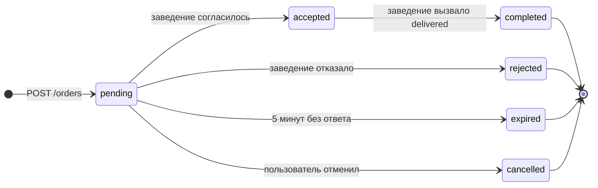

# План реализации «Авито.Кухня»

Как устроена платформа и как работает каждая её часть: из чего она состоит, какие пути проходят пользователь и заведение, как живёт заказ. Это переработанная для чтения версия [исходного плана](kitchen_mvp_plan.md), по которому писался код. Документ меняется вместе с кодом.

Почему выбрано именно так и что рассматривалось вместо этого — в [decisions.md](decisions.md), ссылки вида «Р5» ведут туда. Как запустить и проверить проект — в [README](../README.md).

## Содержание

1. [Из чего состоит система](#1-из-чего-состоит-система)
2. [Путь пользователя и заведения](#2-путь-пользователя-и-заведения)
3. [Статусы заказа](#3-статусы-заказа)
4. [База данных](#4-база-данных)
5. [API](#5-api)
6. [Создание заказа](#6-создание-заказа)
7. [Как заказ получает ответ заведения](#7-как-заказ-получает-ответ-заведения)
8. [Остаток при отказе](#8-остаток-при-отказе)
9. [Рейтинг](#9-рейтинг)
10. [Статусы заведения и поток событий для клиента](#10-статусы-заведения-и-поток-событий-для-клиента)
11. [Эмулятор заведения `testapi`](#11-эмулятор-заведения-testapi)
12. [Раскладка кода](#12-раскладка-кода)

## 1. Из чего состоит система

### Сервисы и хранилища

- **`kitchen`** — сама платформа. Отдаёт два API: B2C для пользователей и B2B для заведений.
- **`testapi`** — эмулятор заведения-партнёра. Свой склад держит в памяти, с платформой общается только через её B2B API и свой вебхук. Общей базы у них нет ([§11](#11-эмулятор-заведения-testapi)).
- **PostgreSQL** — всё состояние платформы: заведения, меню с остатками, заказы, оценки. Других копий этого состояния нет.
- **Redis** — только то, потеря чего не ломает заказы: поток событий по каждому заказу, из которого клиент получает статусы, и ключи, по которым отсекаются повторные запросы на создание заказа.

Почему хранилища разделены именно так — [Р1](decisions.md#р1-postgres--единственное-хранилище-состояния), [Р2](decisions.md#р2-redis--только-для-того-что-можно-потерять).

### Кто с кем разговаривает

| Кто → куда | Как | Зачем |
|---|---|---|
| Пользователь → `kitchen` | B2C API, HTTP + JSON, без аутентификации | каталог, заказы, отмена, оценка |
| `kitchen` → пользователь | SSE: долгий HTTP-ответ, в который сервер дописывает события | статус заказа в реальном времени |
| Заведение → `kitchen` | B2B API, HTTP + JSON, заголовок `X-API-Key` | регистрация, меню, ход готовки, доставка |
| `kitchen` → заведение | `POST` на вебхук — адрес, который заведение указало при регистрации | спросить решение по заказу |

Решение по заказу заведение не присылает само: оно отвечает на наш запрос, в теле того же ответа ([Р11](decisions.md#р11-заведение-отвечает-на-заказ-сразу)).

### Домены внутри `kitchen`

`kitchen` — модульный монолит: один процесс, код которого разделён на две части с явной границей — домены `places` и `orders` ([Р3](decisions.md#р3-модульный-монолит)).

**`places`** — то, что заведение сообщает о себе: карточка (адрес, часы работы, часовой пояс, вебхук), включено ли оно, и меню — названия, описания, цены, остатки. Пишет сюда только само заведение через B2B API, а пользователь всё это читает в каталоге.

**`orders`** — жизнь конкретного заказа: создание с резервом остатка, статусы и переходы, запрос решения у заведения, возврат остатка при отказе и отмене, поток статусов для клиента, сообщения заведения о готовке, оценка. Пишут сюда оба участника, но только определёнными операциями: пользователь создаёт, отменяет и оценивает заказ, заведение сообщает о готовке и доставке.

Кто какими таблицами владеет:

| Таблица | Владелец | Что с ней делает другой домен |
|---|---|---|
| `places` | `places` | `orders` читает вебхук, часы работы и название |
| `products` | `places` | `orders` читает названия и цены и меняет **только** `stock_quantity`: резерв, возврат, обнуление |
| `place_ratings` | `orders` | `places` читает рейтинг для каталога |
| `orders`, `order_items`, `users`, `order_tracking`, `order_ratings` | `orders` | `places` не трогает |

Запись остатка из `orders` — единственная запись одного домена в таблицу другого. Она нужна, чтобы резерв и создание заказа шли одной транзакцией. Что это за компромисс и как его снимать при росте — [Р13](decisions.md#р13-таблица-products-общая-для-двух-доменов).

### Слои внутри домена

Оба домена разложены одинаково:

- `transport/http` — хендлеры: разбор и валидация запроса, коды ответов, аннотации для OpenAPI.
- `service` — бизнес-логика, а в `orders` ещё и границы транзакций.
- `infra/postgres` — репозиторий. У `orders` рядом ещё `infra/redis` (поток событий и ключи повторов) и `infra/webhook` (HTTP-клиент к заведению).
- `domain` — модели, статусы и ошибки, не импортирует ничего.
- `di` — сборка домена на `go.uber.org/fx`.

Транзакцию открывает сервис: оборачивает шаги в `trm.Do` из `go-transaction-manager`, и транзакция передаётся дальше через `context`. Репозиторий берёт соединение вызовом `DefaultTrOrDB(ctx, pool)` — из текущей транзакции, если она есть, иначе из пула. Поэтому один и тот же метод репозитория работает и в транзакции, и вне её, а в его сигнатуре нет ни `tx`, ни колбэков ([Р4](decisions.md#р4-транзакции-открывает-сервис-правила-держит-sql)).

### `orders` изнутри: запрос и фон

`orders` разрезан ещё раз — по тому, кто выполняет работу:

- **`service`** — всё, что происходит внутри HTTP-запроса: создать заказ, отменить, отдать карточку, принять оценку, отметить доставку, подписать клиента на поток событий.
- **`decisions`** — фоновая часть: запрашивает решение у заведения, повторяет попытки, применяет решение к заказу и раз в 30 секунд подбирает из таблицы заказы, которые ждут решения, но никем не обрабатываются ([§7](#7-как-заказ-получает-ответ-заведения)).

Друг друга они не импортируют. Создав заказ, `service` вызывает `Notify` у интерфейса `Notifier`, который сам же и объявил. Реализует его `decisions.Processor`, а соединяет их только `orders/di`. Там же стоят проверки на этапе компиляции: `*postgres.Repo` подходит под все четыре интерфейса репозиториев, `*decisions.Processor` — под `Notifier`.

Интерфейс объявляет тот, кто им пользуется, поэтому у двух частей они разные: `service` поток событий нужен целиком — публиковать и подписываться для SSE, — а `decisions` только публикует. Обоим подходит одна реализация из `orders/infra/redis`. Про вебхук знает только `decisions`.

Через границу доменов идёт один импорт: B2B-ручки `orders` (`delivered`, `tracking`) проверяют ключ заведения через сервис `places`. `places` про заказы не знает ничего.

### Идентификаторы

Каждую сущность адресуют на языке того, кому она принадлежит.

- **Товар.** Идентификаторов два: наш `product_id` (UUID) и артикул заведения `external_id`, уникальный в пределах заведения. Пользователь работает с `product_id`. Заведение — только с `external_id`: в правках меню, в составе заказа на вебхуке и в списке недоступных позиций при отказе. Сопоставление идёт по паре `(place_id, external_id)`, на ней стоит уникальный индекс. Наши UUID товаров в B2B не попадают.
- **Заказ** — один `order_id` для всех: заказ создаёт платформа, своего номера у заведения для него нет.
- **Заведение** — `place_id`, который заведение получает при регистрации.

В каталоге — меню и поиске — артикулов нет. В карточке заказа (`GET /orders/{id}`) у каждой позиции рядом с названием отдаётся её `external_id`. Почему граница проведена так — [Р5](decisions.md#р5-заведение-работает-со-своими-артикулами).

### Стек

| Задача | Чем | Почему так |
|---|---|---|
| Язык | Go 1.26.5, версия зафиксирована в `go.mod` | |
| Сборка приложения, запуск и остановка фоновых частей | `go.uber.org/fx` | [Р4](decisions.md#р4-транзакции-открывает-сервис-правила-держит-sql) |
| Транзакции на уровне сервиса | `avito-tech/go-transaction-manager` | [Р4](decisions.md#р4-транзакции-открывает-сервис-правила-держит-sql) |
| База | PostgreSQL, драйвер `pgx/v5` | [Р1](decisions.md#р1-postgres--единственное-хранилище-состояния) |
| Поток событий, ключи повторов | Redis, `go-redis/v9` | [Р2](decisions.md#р2-redis--только-для-того-что-можно-потерять) |
| Миграции | `goose/v3`, накатываются сервисом при старте | |
| Валидация входа | `go-playground/validator` | |
| Конфигурация | `caarlos0/env`: структуры с тегами вместо ручного разбора окружения | |
| Логи | `zap`. На `info` — то, чего больше нигде нет, на `debug` — жизнь заказа | |
| OpenAPI | `swaggo`: спека собирается из аннотаций в хендлерах | [Р6](decisions.md#р6-спека-из-кода-а-не-код-из-спеки) |
| Тесты | `testcontainers`: Postgres и Redis поднимаются в контейнерах, сервис запускается отдельным процессом, тесты ходят к нему по HTTP | [Р16](decisions.md#р16-тесты-только-внешние) |
| Линтер | `golangci-lint`, конфигурация в `.golangci.yml` | |
| Запуск | Docker Compose: Postgres, Redis, `kitchen`, `testapi` | |

## 2. Путь пользователя и заведения

Оба пути есть в виде CJM-диаграмм: [путь пользователя](diagrams/cjm-user.svg) и [путь заведения](diagrams/cjm-place.svg). Здесь то же самое текстом — с ручками и с тем, что происходит внутри.

### 2.1. Путь пользователя

1. **Выбирает, где и что заказать.** Входов в каталог два:
   - от заведения: `GET /places` — список с фильтрами по городу, типу, названию и минимальному рейтингу и с сортировкой по рейтингу. Дальше `GET /places/{id}` — карточка с часами работы, признаком «открыто сейчас» и рейтингом, и `GET /places/{id}/menu` — меню с остатками.
   - от блюда: `GET /products?search=…` — поиск сразу по всем активным заведениям. У каждой находки указано заведение и открыто ли оно.

   Закончившиеся позиции из меню не пропадают, а отдаются с нулевым остатком. «Открыто сейчас» считает база по часовому поясу заведения.
2. **Оформляет заказ.** `POST /orders` с `user_id`, `place_id`, позициями и заголовком `Idempotency-Key`. Одной транзакцией платформа проверяет, что заведение работает, резервирует остаток по всем позициям и записывает заказ. Клиент сразу получает `201` с `order_id` и статусом `pending`: заведение ещё не спрашивали, и ждать его клиент не должен.
3. **Следит за заказом.** `GET /orders/{id}/stream` — SSE. Сначала приходит вся накопленная история, затем новые события по мере появления. В каждом событии есть поле `source`: `platform` — статус заказа на платформе, `place` — сообщение заведения о готовке.
4. **Платформа спрашивает заведение.** Уже в фоне, вне HTTP-запроса: `decisions` отправляет состав заказа на вебхук заведения и ждёт решения в ответе. При сбое повторяет попытку с нарастающей паузой. Всего на ответ даётся 5 минут с момента создания заказа ([§7](#7-как-заказ-получает-ответ-заведения)).
5. **Заведение соглашается** — заказ становится `accepted`, клиент видит это в потоке.
6. **Заведение готовит** и сообщает о ходе дела: `cooking`, потом `ready`. Эти события приходят в тот же поток с `source: place`, но статус заказа не меняют — это отдельная дорожка ([§10](#10-статусы-заведения-и-поток-событий-для-клиента)).
7. **Заведение отдаёт заказ** и вызывает `delivered` — заказ становится `completed`.
8. **Пользователь оценивает заказ:** `POST /orders/{id}/rate`, от 1 до 5, один раз. Оценка сразу учитывается в рейтинге заведения в каталоге.

В любой момент заказ можно открыть целиком — `GET /orders/{id}`: позиции, цены на момент покупки, сумма, название заведения. Есть история сообщений заведения (`GET /orders/{id}/tracking`) и список своих заказов (`GET /users/{user_id}/orders`). Везде, где нужен конкретный заказ, `user_id` передаётся явно и сверяется с владельцем.

### 2.2. Когда что-то идёт не так

| Ситуация | Что получает пользователь | Что происходит внутри |
|---|---|---|
| Заведение закрыто или выключено | `409`, `place is closed` | Проверка идёт до резерва. Часы «через полночь», когда `closes_at` меньше `opens_at`, учитываются. |
| Не хватает остатка | `409` и список проблемных позиций: `product_id`, сколько просили, сколько есть | Резерв — один `UPDATE` по всем позициям с условием `stock_quantity >= qty`, одинаковые позиции суммируются. Не хватило хоть одной — откатывается вся транзакция, частичного резерва не остаётся. |
| В заказе товар другого заведения или удалённый | `400` | Перед резервом товары выбираются с блокировкой по `place_id`. Если нашлось меньше, чем запрошено, — отказ. |
| Повтор с тем же `Idempotency-Key` | тот же `order_id`, второй заказ не создаётся | Ответ хранится в Redis 24 часа. Тот же ключ с другим телом — `422`, а пока первый запрос ещё выполняется — `409`. |
| Заведение отказало | `rejected` в потоке | Остаток возвращается. При причине `out_of_stock` перечисленные заведением позиции не возвращаются, а обнуляются ([§8](#8-остаток-при-отказе)). |
| Заведение молчит или отвечает не по формату | через 5 минут — `expired` | Ответ не в формате считается неудачной попыткой наравне с сетевой ошибкой. Остаток возвращается. |
| Платформу перезапустили, пока ждали заведение | ничего: заказ доходит до решения | При остановке заказ остаётся `pending`, после старта фоновый проход находит его в таблице и продолжает ([§7](#7-как-заказ-получает-ответ-заведения)). |
| Пользователь передумал | отмена проходит, пока заказ `pending`, после — `409` | Остаток возвращается. Заведение об отмене не узнаёт: такой ручки в B2B-контракте нет ([упрощение](decisions.md#отмена-не-доходит-до-заведения)). |
| Оборвалось SSE-соединение | при переподключении — снова вся история, затем новые события | История хранится в потоке Redis сутки. |
| Запрос к чужому заказу | `404` | Чужой заказ неотличим от несуществующего ([Р7](decisions.md#р7-соглашения-api)). |
| Оценка чужого, недоставленного или уже оценённого заказа | `404`, `409`, `409` | Проверка и вставка — один SQL-запрос, а одну оценку на заказ держит уникальный индекс. |

### 2.3. Путь заведения

Всё, кроме регистрации, — обмен запросами между системами, без участия человека. Все B2B-запросы, кроме регистрации, идут с заголовком `X-API-Key`. Если `place_id` в пути не совпадает с заведением ключа — `403`. Если заказ принадлежит другому заведению — `404`.

1. **Регистрация.** `POST /b2b/places`: название, город, адрес, часовой пояс, часы работы, тип и вебхук. В ответ — `place_id` и `api_key`. Ключ показывается один раз, в базе хранится только его SHA-256. Регистрация открыта: ключ получает любой, кто вызвал ручку, — это [упрощение MVP](decisions.md#регистрация-заведения-открыта-всем).
2. **Меню.** `POST /b2b/places/{id}/menu` — массив позиций, у каждой свой `external_id` и стартовый остаток. В ответ приходят только подтверждённые `external_id`, наших идентификаторов заведение не получает.
3. **Поддержание меню.** `PATCH /b2b/places/{id}/menu/{external_id}`: название, описание и цена перезаписываются, а остаток меняется на `stock_delta` — на разницу, а не на абсолютное значение. При отрицательной разнице обязателен `reason`, он пишется в лог. `DELETE` по тому же адресу снимает позицию мягко (`is_deleted`), повторный `DELETE` — тоже `200`. Заказы, в которых позиция уже есть, доживают как обычно.
4. **Приём заказа.** Платформа шлёт `POST` на вебхук:

   ```json
   { "order_id": "…", "place_id": "…", "total_amount": "1180.00",
     "items": [{ "external_id": "pizza-margherita", "name": "Пицца Маргарита", "quantity": 2, "price": "590.00" }] }
   ```

   Ответить нужно в теле этого же запроса, за 10 секунд:

   ```json
   { "decision": "rejected", "reason": "out_of_stock", "unavailable_external_ids": ["pizza-margherita"] }
   ```

   `decision` — `accepted` или `rejected`. Поля `reason` и `unavailable_external_ids` нужны только при отказе. Код не `200`, тело не в этом формате или отсутствие ответа — неудачная попытка, её повторят. Повтор возможен и после успешного ответа, поэтому вебхук обязан отвечать на один `order_id` одинаково: на повтор — прежнее решение, без второго списания у себя.
5. **Ход готовки.** `POST /b2b/orders/{id}/tracking`: собственный код заведения (`external_code`), соответствующий ему статус из словаря платформы (`accepted`, `cooking`, `ready`, `handed_over`) и время события. Ответ `202`: событие сохранено и отправлено пользователю, статус заказа не изменился.
6. **Доставка.** `POST /b2b/orders/{id}/delivered` — заказ из `accepted` переходит в `completed`. Повторный вызов — `200` без изменений, вызов для заказа в другом статусе — `409`.
7. **Остатки расходятся.** Заведение продаёт и мимо платформы, поэтому наш остаток отстаёт от того, что у него на самом деле лежит. Отдельной синхронизации нет: когда приходит заказ на то, чего уже нет, заведение отвечает `rejected` с `reason: out_of_stock` и своими артикулами, и платформа обнуляет эти позиции у себя. Артикулы не из этого заказа игнорируются и пишутся в лог. Почему так и чем это плохо — [Р12](decisions.md#р12-остаток-на-платформе--копия-со-слов-заведения).

## 3. Статусы заказа



Статус хранится в `orders.order_status`. Допустимые значения ограничены в базе `CHECK`-ом `orders_status_known`.

| Переход | Кто его делает | Что ещё происходит в той же транзакции |
|---|---|---|
| → `pending` | `POST /orders` | резерв остатка, запись заказа и позиций, заказ закрепляется за инстансом ([§6](#6-создание-заказа)) |
| `pending` → `accepted` | `decisions`, заведение ответило `accepted` | ничего |
| `pending` → `rejected` | `decisions`, заведение ответило `rejected` | возврат остатка, при `out_of_stock` обнуление перечисленных позиций ([§8](#8-остаток-при-отказе)) |
| `pending` → `expired` | `decisions`, за 5 минут не пришло ни одного ответа в нужном формате | возврат остатка |
| `pending` → `cancelled` | `POST /orders/{id}/cancel` | возврат остатка |
| `accepted` → `completed` | `POST /b2b/orders/{id}/delivered` | ничего |

После коммита каждого перехода в поток событий заказа уходит событие с новым статусом и `source: platform` ([§10](#10-статусы-заведения-и-поток-событий-для-клиента)).

Каждый переход — условный `UPDATE`: `SET order_status = <новый> WHERE id = $1 AND order_status = <ожидаемый>`. Если строка не обновилась, перехода не было, и вызывающий решает, что ответить:

- повтор перехода, который уже случился (`delivered` на заказе в `completed`), — `200` без изменений,
- любой другой случай — `409`,
- опоздавшее решение заведения (заказ уже отменили) пишется в лог и больше ни на что не влияет.

Отмена и решение заведения конкурируют за один и тот же `pending`. Выигрывает тот, чей `UPDATE` прошёл первым, второй получает ноль строк. Перезаписать друг друга они не могут.

Терминальные статусы — `rejected`, `expired`, `cancelled` и `completed`, переходов из них нет. Незавершённых два. `pending` ограничен пятью минутами ожидания. У `accepted` срока нет: выйти из него можно только через `delivered` от заведения ([упрощение](decisions.md#у-accepted-нет-срока)).

Статусы, которые сообщает заведение (`cooking`, `ready` и другие), в этот список не входят и `order_status` не меняют ([§10](#10-статусы-заведения-и-поток-событий-для-клиента)).

## 4. База данных

Схема целиком — на [диаграмме](diagrams/db-schema.svg). Миграции лежат в `services/kitchen/migrations`, встроены в бинарник через `go:embed` и накатываются `goose` при старте сервиса.

Общие правила:

- Первичные ключи — UUID без значений по умолчанию в базе: их генерирует Go-код, а `users.id` присылает клиент.
- Деньги — `NUMERIC(12,2)`. В Go цена и сумма живут строками и во `float` не переводятся, суммы считает база.
- Время событий — `TIMESTAMPTZ`. Часы работы заведения — `TIME` в его местном времени.
- Внешние ключи стоят на всех связях, каскадных удалений нет.

### Таблицы

**`users`** — `id`, `created_at`. Заглушка вместо пользователей: `id` присылает клиент, строка заводится при первом заказе через `INSERT ... ON CONFLICT DO NOTHING`.

**`places`** — `id`, `name`, `description`, `city`, `address`, `timezone` (IANA, например `Europe/Moscow`), `opens_at`, `closes_at`, `place_type`, `webhook_url`, `api_key_hash`, `is_active` (по умолчанию `true`), `created_at`. Значения `place_type` (`restaurant`, `cafe`, `shop`) ограничены валидатором на входе, в базе это `TEXT`. `api_key_hash` — SHA-256 ключа в hex.

**`products`** — `id`, `external_id`, `place_id`, `name`, `description`, `price`, `stock_quantity` (по умолчанию 0), `is_deleted`, `created_at`, `updated_at`. Ограничения: `UNIQUE (place_id, external_id)`, `products_price_non_negative` (`price >= 0`) и `products_stock_non_negative` (`stock_quantity >= 0`). Два последних названы явно: по имени нарушенного ограничения репозиторий отличает отрицательную цену (`400`) от ухода остатка в минус (`409`). Удаление только мягкое, через `is_deleted`.

**`orders`** — `id`, `user_id`, `place_id`, `order_status`, `total_amount`, `locked_by`, `locked_at`, `created_at`, `updated_at`. Ограничения: `total_amount >= 0` и `orders_status_known` ([§3](#3-статусы-заказа)). `locked_by` и `locked_at` — какой инстанс владеет заказом и когда он это последний раз подтвердил ([§7](#7-как-заказ-получает-ответ-заведения)).

**`order_items`** — `id`, `order_id`, `product_id`, `quantity` (`> 0`), `price` (`>= 0`). Цена копируется из `products` в момент заказа, поэтому смена цены в меню на оформленные заказы не влияет. Повторы одного товара в запросе дают отдельные строки.

**`order_tracking`** — `id`, `order_id`, `source` (`place` или `delivery`), `external_code`, `status` (`accepted`, `cooking`, `ready`, `handed_over`), `occurred_at`, `received_at`. Строки только добавляются. `occurred_at` — время события по часам заведения, `received_at` — по нашим.

**`order_ratings`** — `id`, `order_id` (`UNIQUE`), `place_id`, `user_id`, `score` (от 1 до 5), `created_at`.

**`place_ratings`** — `place_id` (первичный ключ), `rating_sum`, `rating_count`. Сумма и количество оценок заведения, среднее считается при чтении ([§9](#9-рейтинг)).

### Индексы

| Индекс | Под какой запрос |
|---|---|
| `places (city, place_type) WHERE is_active` | каталог заведений с фильтрами |
| `products (place_id) WHERE NOT is_deleted` | меню заведения |
| `products UNIQUE (place_id, external_id)` | позиция по артикулу в B2B |
| `orders (user_id, created_at DESC)` | история заказов пользователя |
| `orders (created_at) WHERE order_status = 'pending'` | фоновый проход по ждущим заказам ([§7](#7-как-заказ-получает-ответ-заведения)) |
| `order_items (order_id)` | позиции заказа |
| `order_ratings UNIQUE (order_id)` | одна оценка на заказ |
| `order_tracking (order_id, occurred_at)` | история сообщений заведения по заказу |

### Вычисляемые поля

**«Открыто сейчас»** считается в SQL одинаково в четырёх местах: список заведений, карточка, поиск блюда и проверка при создании заказа. Текущее время переводится в часовой пояс заведения через `now() AT TIME ZONE timezone`. Если `opens_at <= closes_at`, заведение открыто при `opens_at <= время < closes_at`. Если `closes_at` меньше, часы идут через полночь, и заведение открыто при `время >= opens_at` или `время < closes_at`.

**Рейтинг** — `round(rating_sum / rating_count, 2)`, если оценки есть, иначе `null`. Рядом всегда отдаётся `rating_count`.

## 5. API

Полная спецификация — `docs/swagger.yaml`, она собирается из аннотаций в хендлерах командой `make docs` ([Р6](decisions.md#р6-спека-из-кода-а-не-код-из-спеки)). Живая страница — `/swagger/` на `kitchen`. Здесь общие правила и список ручек с кодами ответов.

### Общие правила

- Все пути начинаются с `/api/v1`. Тела запросов и ответов — JSON.
- Ошибка — `{"error": "<текст>"}`. Единственное исключение — `409` при нехватке остатка, у него рядом ещё `items` ([§6](#6-создание-заказа)).
- Тела запросов разбираются строго: неизвестное поле — `400`. Тело `POST /orders` читается не больше 1 МБ.
- UUID в путях, query и заголовках проверяются. Принимаются в любом регистре и приводятся к нижнему.
- Необязательные query-параметры разбираются мягко. `limit` по умолчанию 20 и не больше 100, `from` (смещение) по умолчанию 0. Не число, отрицательное значение или переполнение заменяются значением по умолчанию, и ответ остаётся `200`. `min_rating`, который не разбирается как конечное число, игнорируется, и фильтра нет ([Р7](decisions.md#р7-соглашения-api)).
- B2C без аутентификации. Владение заказом проверяется по `user_id`: в query у `GET`-ручек заказа и в теле у `cancel` и `rate`. Чужой заказ отвечает `404` ([Р7](decisions.md#р7-соглашения-api)).
- B2B — заголовок `X-API-Key`. Платформа считает от него SHA-256 и ищет заведение. Нет заголовка или ключ неизвестен — `401`. `place_id` в пути не совпадает с заведением ключа — `403`. Заказ другого заведения — `404`. Выключенное заведение (`is_active = false`) доступ к B2B сохраняет, иначе не смогло бы включиться обратно.
- CORS открыт: `Access-Control-Allow-Origin: *`, методы `GET`, `POST`, `PATCH`, `DELETE`, заголовки `Content-Type`, `X-API-Key`, `Idempotency-Key`. Preflight отвечает `204` и кэшируется на 10 минут.

Ограничения полей:

- Длина строк: `name` до 200, `description` до 2000, `city` до 100, `address` до 300, `external_id` до 200, `reason` до 500, `external_code` до 64 символов.
- `price` — строка с неотрицательным числом. `stock_quantity` не меньше 0.
- `timezone` должен находиться в базе часовых поясов Go. `webhook_url` — только `http` или `https`. `opens_at` и `closes_at` — в формате `ЧЧ:ММ:СС`.

### B2C

| Ручка | Вход | Успех | Ошибки |
|---|---|---|---|
| `GET /places` | `city`, `type`, `search`, `min_rating`, `sort=rating`, `limit`, `from` | `200`, список заведений | — |
| `GET /places/{id}` | | `200`, заведение | `400` кривой id, `404` нет или выключено |
| `GET /places/{id}/menu` | `search`, `limit`, `from` | `200`, позиции без `external_id` | `400`, `404` |
| `GET /products` | `search`, `city`, `type`, `limit`, `from` | `200`, позиции с вложенным `place` | — |
| `POST /orders` | заголовок `Idempotency-Key`, тело: `user_id`, `place_id`, `items` (от 1 до 100 строк, `quantity` от 1 до 1000) | `201`, `order_id` и `status` | `400`, `404` нет заведения, `409` закрыто, нет остатка или ключ ещё в работе, `422` ключ с другим телом |
| `GET /orders/{id}` | `user_id` | `200`, заказ с позициями и названием заведения | `400`, `404` |
| `GET /orders/{id}/tracking` | `user_id` | `200`, сообщения заведения по времени | `400`, `404` |
| `GET /orders/{id}/stream` | `user_id` | `200`, поток SSE ([§10](#10-статусы-заведения-и-поток-событий-для-клиента)) | `400`, `404` |
| `POST /orders/{id}/cancel` | тело: `user_id` | `200` | `400`, `404`, `409` заказ уже не `pending` |
| `POST /orders/{id}/rate` | тело: `user_id`, `score` от 1 до 5 | `200` | `400`, `404`, `409` не доставлен или уже оценён |
| `GET /users/{user_id}/orders` | `limit`, `from` | `200`, сводка заказов: статус, сумма, заведение, время | `400` |

### B2B

| Ручка | Вход | Успех | Ошибки |
|---|---|---|---|
| `POST /b2b/places` | `name`, `description`, `city`, `address`, `timezone`, `opens_at`, `closes_at`, `type`, `webhook_url` | `201`, `place_id` и `api_key` | `400` |
| `PATCH /b2b/places/{id}` | любое подмножество полей регистрации и `is_active` | `200` | `400`, `401`, `403`, `404` |
| `POST /b2b/places/{id}/menu` | массив позиций: `external_id`, `name`, `description`, `price`, `stock_quantity` | `201`, список `external_id` | `400`, `401`, `403`, `409` артикул уже есть |
| `PATCH /b2b/places/{id}/menu/{external_id}` | `name`, `description`, `price`, `stock_delta`, `reason` | `200` | `400`, `401`, `403`, `404`, `409` остаток ушёл бы в минус |
| `DELETE /b2b/places/{id}/menu/{external_id}` | | `200`, в том числе на повтор | `400`, `401`, `403`, `404` артикула никогда не было |
| `POST /b2b/orders/{id}/tracking` | `external_code`, `status`, `occurred_at` | `202` | `400`, `401`, `404` |
| `POST /b2b/orders/{id}/delivered` | | `200`, в том числе на повтор | `400`, `401`, `404`, `409` заказ не `accepted` |

Контракт вебхука, который платформа вызывает у заведения, — [§2.3](#23-путь-заведения), шаг 4.

### Служебные ручки

- `/healthz` — процесс жив. Всегда `200`, в зависимости не ходит.
- `/readyz` — у `kitchen` пингует Postgres и Redis с таймаутом 2 секунды. Если что-то недоступно, `503` и причина по каждой проверке. У `testapi` проверок нет, ответ всегда `200`.
- Успешные пробы не пишутся в лог, неуспешные пишутся.

## 6. Создание заказа

`POST /orders` проходит четыре этапа.

### Разбор запроса

Хендлер проверяет, что `Idempotency-Key` — UUID, читает тело (не больше 1 МБ), разбирает и валидирует его. От сырого тела считается SHA-256: по нему повтор того же запроса отличается от нового запроса с тем же ключом.

### Ключ повтора

В Redis ставится ключ `idem:orders:<Idempotency-Key>` командой `SET NX` — запись, только если ключа ещё нет. Значение — `{"body_hash": "…"}`, срок жизни 30 секунд. Дальше два пути.

- Ключ поставлен — запрос первый, заказ создаётся.
- Ключ уже есть. Хеш тела другой — `422`. В значении уже лежит `order_id` — ответ `201` с тем же `order_id` и статусом, второй заказ не создаётся. `order_id` ещё нет — первый запрос пока выполняется, ответ `409`.

Если создать заказ не удалось, ключ удаляется, чтобы клиент мог повторить запрос с тем же ключом. Если удалось — в ключ записывается `{"body_hash", "order_id", "status"}` со сроком жизни 24 часа. Ошибка этой записи только пишется в лог ([Р8](decisions.md#р8-повтор-заказа-отсекается-ключом-в-redis)).

### Транзакция

Внутри `trm.Do`, по порядку:

1. `users`: `INSERT ... ON CONFLICT DO NOTHING`.
2. Заведение: `webhook_url`, `is_active` и вычисленное «открыто сейчас» ([§4](#4-база-данных)). Нет такого заведения — `404`. Выключено или закрыто — `409`.
3. Блокировка товаров: `SELECT id FROM products WHERE place_id = $1 AND id = ANY($2) AND NOT is_deleted ORDER BY id FOR UPDATE`. Если строк меньше, чем уникальных `product_id` в запросе, какой-то товар чужой или удалён — `400`. Сортировка по `id` задаёт порядок блокировок, общий для всех путей, где меняется остаток ([§8](#8-остаток-при-отказе)).
4. Резерв одним запросом. CTE `requested` суммирует количество по каждому `product_id`, так что повторы одного товара складываются. Затем `UPDATE products SET stock_quantity = stock_quantity - qty ... WHERE stock_quantity >= qty`. Запрос возвращает позиции, которые зарезервировать не удалось, с запрошенным и доступным количеством. Если такие есть — транзакция откатывается целиком, ответ `409` со списком `items`.
5. Запись заказа одним запросом из трёх CTE. `priced` соединяет строки запроса с `products` и берёт текущие цены. Вставка в `orders` идёт сразу с итоговой суммой `SUM(quantity * price)`, статусом `pending`, `locked_by` — идентификатором этого инстанса и `locked_at = now()`. Вставка в `order_items` пишет по строке на каждую позицию запроса с ценой на момент заказа. Запрос возвращает `total_amount` и `created_at`.

`order_id` генерирует сервис до транзакции, идентификаторы позиций — репозиторий, когда собирает запрос.

### После коммита

1. В поток событий заказа публикуется `pending` ([§10](#10-статусы-заведения-и-поток-событий-для-клиента)). Ошибка публикации только пишется в лог.
2. Заказ передаётся в `decisions` через `Notifier` ([§7](#7-как-заказ-получает-ответ-заведения)). Передача не блокирует: если буфер на 256 заказов переполнен, уведомление отбрасывается, и заказ подберёт фоновый проход.
3. Клиент получает `201` с `order_id` и статусом `pending`.

## 7. Как заказ получает ответ заведения

Этим занимается `decisions.Processor`. `fx` запускает его при старте приложения и останавливает при выключении. Почему для этого нет внешней очереди — [Р9](decisions.md#р9-внешней-очереди-нет).

### Кто запускает работу по заказу

По каждому заказу в `pending` работает отдельная горутина — воркер. Запустить её могут двое:

- `service` сразу после создания заказа, через `Notify`,
- фоновый проход (reconciler) — при старте инстанса и затем каждые 30 секунд.

Процессор держит в памяти множество заказов, по которым воркер уже идёт, и второй воркер на тот же заказ в том же процессе не запускает.

### Воркер

1. Дедлайн воркера — `created_at` плюс 5 минут. Контекст воркера унаследован от контекста процессора, поэтому при остановке приложения он отменяется.
2. Воркер загружает заказ целиком: позиции с `external_id`, названиями, количеством и ценой.
3. Отправляет `POST` на вебхук заведения ([§2.3](#23-путь-заведения), шаг 4) с таймаутом 10 секунд. Попытка удачна, только если пришёл код `200`, тело разобралось (читается не больше 64 КБ) и `decision` — `accepted` или `rejected`.
4. После неудачной попытки ждёт и пробует снова. Пауза начинается с 2 секунд и удваивается, пока не превысит минуту: 2, 4, 8, 16, 32, 64 секунды, дальше по 64. Перед каждой следующей попыткой проверяет в базе, что заказ всё ещё `pending`. Если его уже отменили, воркер больше не звонит заведению и выходит.
5. Удачный ответ — решение применяется. Дедлайн истёк — применяется `expired`. Процессор остановили — воркер выходит и ничего не меняет, заказ остаётся `pending`, его подберёт этот или другой инстанс.

### Применение решения

Решение применяется в отдельной транзакции со своим таймаутом 10 секунд. Этот таймаут не наследует отмену от процессора, чтобы остановка приложения не оборвала уже начатую запись.

1. Условный `UPDATE orders SET order_status = <решение> WHERE id = $1 AND order_status = 'pending'`.
2. Строка не обновилась — заказ уже завершён другим путём, например отменён. Это пишется в лог, больше ничего не происходит.
3. Решение `accepted` — на этом всё.
4. Иначе в той же транзакции возвращается или обнуляется остаток ([§8](#8-остаток-при-отказе)).
5. После коммита в поток событий публикуется новый статус.

### Владение заказом между инстансами

Инстансов `kitchen` может быть несколько. Чтобы вебхук по одному заказу не отправляли двое, у заказа есть владелец — аренда (лиз) на ограниченное время.

- `locked_by` — идентификатор инстанса, `hostname:port`. Если имя хоста получить не удалось, вместо него берётся случайный UUID.
- `locked_at` — когда владелец последний раз подтвердил аренду.
- Аренда истекает, если `locked_at` старше 90 секунд.

Владелец ставится сразу при создании заказа ([§6](#6-создание-заказа)). Каждый проход reconciler делает два шага.

1. **Продление.** `UPDATE orders SET locked_at = now() WHERE id = ANY(<заказы с живым воркером>) AND locked_by = <этот инстанс> AND order_status = 'pending'`.
2. **Захват.** В транзакции выбираются заказы в `pending`, по которым у этого инстанса нет живого воркера и у которых владелец — этот же инстанс, владельца нет или аренда истекла. Не больше 100 за проход, старые первыми, с `FOR UPDATE SKIP LOCKED`, чтобы два инстанса не взяли одни и те же строки. Выбранным ставится `locked_by` этого инстанса и `locked_at = now()`.

По захваченным заказам: если с создания прошло больше 5 минут, сразу применяется `expired`. Иначе запускается воркер.

Идентификатор инстанса переживает перезапуск, поэтому перезапущенный инстанс забирает свои заказы на первом же проходе, не дожидаясь конца аренды. Чужие заказы он забирает только после того, как их аренда истекла. Почему аренда хранится в таблице, а не блокировкой в Redis, — [Р10](decisions.md#р10-заказ-закрепляется-арендой-в-таблице).

### Остановка

При остановке процессор отменяет свой контекст и ждёт, пока завершатся цикл reconciler и все воркеры. Начатые запросы к вебхукам обрываются, заказы остаются `pending`.

### Повторные вызовы вебхука

Вебхук по одному заказу может прийти к заведению повторно: например, инстанс перезапустился посреди повторов или упал между ответом заведения и коммитом. Поэтому заведение обязано отвечать на один `order_id` одинаково ([§2.3](#23-путь-заведения)). На нашей стороне повторное применение решения ничего не меняет, потому что `UPDATE` ждёт статус `pending`.

## 8. Остаток при отказе

Остаток меняют три пути из `orders` и один из `places`.

| Когда | Что делается |
|---|---|
| создание заказа | резерв: остаток уменьшается на количество в заказе ([§6](#6-создание-заказа)) |
| `rejected` с другой причиной, `expired`, `cancelled` | возврат: остаток увеличивается на количество в заказе |
| `rejected` с `reason: out_of_stock` | позиции из `unavailable_external_ids` обнуляются, остальные возвращаются |
| заведение правит меню | остаток меняется на `stock_delta` |

### Возврат

Один запрос. Сначала материализованный CTE блокирует товары заказа: `... ORDER BY p.id FOR UPDATE`. Затем количество из `order_items` суммируется по каждому `product_id` и прибавляется к `stock_quantity`. Товары, чьи `external_id` переданы в списке исключений, пропускаются.

### Обнуление

Выполняется в той же транзакции сразу после возврата. Тот же CTE с блокировкой, затем `stock_quantity = 0` для товаров этого заказа, чьи `external_id` есть в списке заведения. Запрос возвращает артикулы, которые обнулил. Артикулы из списка, которых в заказе нет, не трогаются и пишутся в лог на уровне `warn`.

### Порядок блокировок

Везде, где одна транзакция меняет несколько строк `products`, они блокируются по возрастанию `id`. При резерве это отдельный `SELECT ... FOR UPDATE` перед `UPDATE`, при возврате и обнулении — материализованный CTE в начале запроса. CTE материализован, чтобы все блокировки были взяты до основного `UPDATE`. Правка меню из `places` меняет одну строку и в цикл блокировок попасть не может.

### Правка остатка заведением

`stock_quantity = stock_quantity + stock_delta`, одним `UPDATE`. Если результат ушёл бы в минус, срабатывает `products_stock_non_negative`, и ответ — `409`. При отрицательной разнице обязателен `reason`. Списание пишется в лог на уровне `info` вместе с причиной, отдельной колонки под причину нет.

Почему отказ с `out_of_stock` обнуляет остаток, а не возвращает, — [Р12](decisions.md#р12-остаток-на-платформе--копия-со-слов-заведения).

## 9. Рейтинг

Оценку ставит пользователь своему доставленному заказу, один раз. У заведения доступа к рейтингу нет ([Р14](decisions.md#р14-рейтинг-считает-платформа)).

### Запись

`POST /orders/{id}/rate` в одной транзакции:

1. `INSERT INTO order_ratings ... SELECT ... FROM orders WHERE id = $2 AND user_id = $3 AND order_status = 'completed' ON CONFLICT (order_id) DO NOTHING RETURNING place_id`. Один запрос проверяет, что заказ есть, принадлежит пользователю и доставлен, и что оценки ещё нет.
2. Строка вставилась — обновляется `place_ratings`: `INSERT ... ON CONFLICT (place_id) DO UPDATE SET rating_sum = rating_sum + score, rating_count = rating_count + 1`.
3. Не вставилась — сервис выясняет причину отдельным запросом. Заказа нет или он чужой — `404`. Статус не `completed` — `409`. Иначе оценка уже есть — `409`.

### Чтение

Рейтинг отдаётся в списке заведений и в карточке ([§4](#4-база-данных)): среднее с двумя знаками после запятой или `null` и рядом `rating_count`.

- `min_rating` оставляет только заведения со средним не ниже заданного. Заведения без оценок отсекаются.
- `sort=rating` сортирует по среднему по убыванию, заведения без оценок считаются нулём. Без `sort` список идёт по времени регистрации, новые первыми.

## 10. Статусы заведения и поток событий для клиента

### Две дорожки статусов

У заказа две независимые дорожки. `order_status` — наш статус, по нему работают все правила ([§3](#3-статусы-заказа)). `order_tracking` — то, что заведение сообщает о готовке. Вторая дорожка на первую не влияет ([Р15](decisions.md#р15-статусы-заведения--отдельная-дорожка)).

`POST /b2b/orders/{id}/tracking`:

1. Тело валидируется. `external_code` — код заведения как есть. `status` — одно из `accepted`, `cooking`, `ready`, `handed_over`. `occurred_at` — время события.
2. Вставка одним запросом: CTE ищет заказ по `id` и `place_id` заведения из ключа. Нет такого заказа у этого заведения — ничего не вставляется, ответ `404`. Иначе вставляется строка с `source = 'place'`, и запрос возвращает `user_id` заказа.
3. После вставки в поток событий публикуется событие с `source: place`.
4. Ответ `202`.

Статус заказа при этом не проверяется, сообщение примут для заказа в любом статусе. `source = 'delivery'` в схеме разрешён, но писать его сейчас некому.

История — `GET /orders/{id}/tracking?user_id=…` — читается из `order_tracking` в Postgres по возрастанию `occurred_at`.

### Поток событий

Для каждого заказа в Redis есть поток (Redis Stream) с ключом `order:<order_id>:events`.

- Запись — `XADD` с полями `status`, `user_id`, `source`. В потоке хранится примерно 10 последних событий (`MAXLEN ~ 10`). Срок жизни ключа 24 часа, он продлевается при каждой записи.
- Пишут оба: `service` (`pending`, `cancelled`, `completed`, сообщения заведения) и `decisions` (`accepted`, `rejected`, `expired`). Всегда после коммита в Postgres, ошибка записи только пишется в лог.
- `user_id` лежит в каждом событии, чтобы владельца можно было проверить по любому сохранившемуся.

### SSE

`GET /orders/{id}/stream?user_id=…`:

1. `XRANGE` читает всю историю потока. Потока нет или он пуст — `404`. `user_id` первого события не совпадает с запросом — `404`.
2. Ответ `200` с заголовками `Content-Type: text/event-stream`, `Cache-Control: no-cache`, `Connection: keep-alive`.
3. Сначала отправляется история, затем в цикле `XREAD` с ожиданием до 5 секунд, начиная с последнего отправленного события.
4. Каждое событие — строка `data: {"order_id": "…", "source": "…", "status": "…"}` и пустая строка за ней.
5. Раз в 20 секунд уходит комментарий `: keepalive`, чтобы соединение не закрыли посредники.
6. Через 30 минут сервер закрывает соединение. Клиент переподключается и снова получает историю.

`WriteTimeout` у HTTP-сервера не задан, иначе он обрывал бы SSE.

Внутри одной дорожки события идут в порядке записи. Между дорожками порядок не гарантирован: `cooking` от заведения может прийти раньше нашего `accepted`.

## 11. Эмулятор заведения `testapi`

Отдельный сервис, который ведёт себя как подключённое заведение. С платформой общается только по HTTP: в одну сторону через B2B API, в другую через свой вебхук.

### Старт

До того как поднимется HTTP-сервер, `testapi`:

1. Регистрируется через `POST /b2b/places`. Данные: «Тестовая Пиццерия», Moscow, `Europe/Moscow`, часы `00:00:00`–`23:59:59`, тип `restaurant`, вебхук — `PUBLIC_URL` плюс `/webhook/orders`. Если платформа не отвечает, повторяет каждые 2 секунды, каждая попытка до 10 секунд, всего до 60 секунд. Не получилось — старт падает.
2. Хранит `place_id` и `api_key` в памяти. Поэтому на каждом рестарте он регистрируется заново ([упрощение](decisions.md#testapi-регистрируется-заново-на-каждом-рестарте)).
3. Заливает меню из пяти позиций. Тот же список — его стартовый склад в памяти.

| `external_id` | Название | Цена | Остаток |
|---|---|---|---|
| `pizza-margherita` | Пицца Маргарита | 590.00 | 20 |
| `pizza-pepperoni` | Пицца Пепперони | 690.00 | 15 |
| `pasta-carbonara` | Паста Карбонара | 540.00 | 12 |
| `salad-caesar` | Салат Цезарь | 430.00 | 10 |
| `drink-lemonade` | Домашний лимонад | 190.00 | 30 |

### Вебхук `POST /webhook/orders`

1. Если по этому `order_id` решение уже принималось, возвращается то же решение, склад не трогается.
2. Иначе проверяется весь заказ. Если каждой позиции хватает, все списываются разом. Если хоть одной не хватает или артикул неизвестен, не списывается ничего, а ответ — `rejected`, `out_of_stock` и отсортированный список недоступных артикулов.
3. Решение запоминается по `order_id`.
4. После `accepted` в фоне уходит сообщение `cooking` с кодом `KITCHEN_QUEUE`, через 300 мс — `ready` с кодом `KITCHEN_DONE`, через `DELIVERY_DELAY` (по умолчанию 30 секунд) — `delivered`.

### Фоновые процессы

- **Продажи мимо платформы.** Каждые `OFFLINE_SALES_INTERVAL` (по умолчанию 20 секунд) выбирается случайная позиция с ненулевым остатком, и списывается до 2 штук. Платформе об этом не сообщается.
- **Пополнение.** Каждые `RESTOCK_INTERVAL` (по умолчанию 60 секунд) выбирается позиция, которой больше всего не хватает до стартового количества. Её остаток восстанавливается, а разница отправляется платформе через `PATCH` со `stock_delta`.

Значение `0` выключает соответствующий процесс. О продажах платформа не узнаёт, а о пополнениях узнаёт, поэтому её остаток со временем уходит вверх от реального.

### Служебное

`/healthz` и `/readyz` всегда отвечают `200`: зависимостей у `testapi` нет, а к моменту, когда поднимается HTTP-сервер, регистрация уже прошла. В Docker Compose `testapi` стартует только после того, как `kitchen` прошёл проверку `/readyz`.

## 12. Раскладка кода

```text
├── config/                       переменные окружения обоих сервисов
├── deploy/docker-compose.yml     Postgres, Redis, kitchen, testapi
├── docs/
│   ├── plan.md, decisions.md     этот документ и обоснования решений
│   ├── kitchen_mvp_plan.md       исходный план, по которому писался код
│   ├── swagger.yaml, .json, docs.go   спека, make docs
│   └── diagrams/                 CJM, C4 и схема БД в PlantUML и SVG, make diagrams
├── pkg/                          общее для обоих сервисов
│   ├── config/                   конфиги сервера, логгера, Postgres и Redis
│   ├── health/                   /healthz и /readyz
│   ├── httpmw/                   логирование запросов и CORS
│   ├── httpsrv/                  http.Server с таймаутами и запуск через fx
│   ├── logger/                   zap
│   ├── redis/                    клиент
│   ├── repo/                     пул, миграции, транзакции, generic-хелперы запросов
│   └── slice/                    Map для мапперов
├── services/
│   ├── kitchen/
│   │   ├── Dockerfile
│   │   ├── cmd/app/main.go
│   │   ├── migrations/           goose, встроены в бинарник
│   │   └── internal/
│   │       ├── di/               сборка приложения
│   │       ├── httpx/            разбор параметров, валидация, ответы
│   │       ├── orders/           domain, service, decisions, infra/{postgres,redis,webhook}, transport/http, di
│   │       └── places/           domain, service, infra/postgres, transport/http, di
│   └── testapi/
│       ├── Dockerfile
│       ├── cmd/app/main.go
│       └── internal/             di, config, stock, client, transport/http
├── tests/                        внешние тесты по HTTP
├── .golangci.yml
└── Makefile                      up, down, logs, build, clean, test, lint, vet, fmt, docs, diagrams
```

SQL-запросы лежат отдельными `.sql`-файлами в `infra/postgres/queries` и встраиваются через `go:embed`. У каждого репозитория свои структуры строк и мапперы в доменные модели.

Переменные окружения описаны в README, раздел «Настройки».
